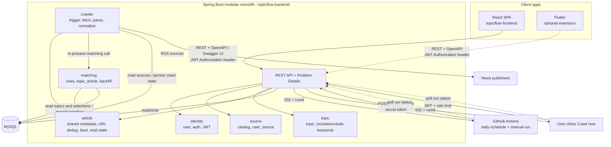

# TopicFlow (TFL) — Implementation Plan

> Portfolio project: a news aggregator organized by **topics** (include and exclude keywords), with optional news sources and read/unread tracking.
> - Jira key: **TFL**
> - Repo: `topicflow-backend` (Spring Boot + MySQL), `topicflow-frontend` (React SPA/PWA), `topicflow-mobile` (Flutter)
> - The backend is intended as a hands-on architecture learning project; the frontend will be built primarily with AI-assisted coding.

---

## 1. Goals and scope

### 1.1 Goals
- Build and deploy a working product to showcase Java/Spring backend skills on a résumé. Follow the Lean route through a stable demo before optional extensions.
- Learn and demonstrate a modular monolith, JPA/Hibernate query and transaction behavior, RSS ingestion, URL-level idempotency, matching, pagination, test slices, and CI. Add virtual threads with a measured benchmark after the sequential crawler works.

### 1.2 MVP scope
- User registration and login (JWT).
- A news source catalog; users can select or deselect sources at any time.
- Topics: each topic can have multiple **INCLUDE** and **EXCLUDE** keywords; users can create multiple topics.
- Crawl daily on a schedule (GitHub Actions calls an endpoint); users can also click “Crawl now,” subject to rate limits. Store metadata only: title, snippet, original URL, thumbnail, publication time, and source. Users follow the link to read the article on the publisher’s site.
- Topic feeds with cursor pagination; opening an article launches its original page in an external browser.
- Read/unread controls: mark an article read or unread, or mark all articles in a topic as read.
- Users can delete their own topics. Lean does not promise per-article trash/restore or a 30-day purge; those independent deletion lifecycles are an extension. Shared article metadata is not deleted when a topic is removed.

### 1.3 Out of MVP (future work)
- Push notifications (FCM), alongside the Flutter phase; HTML parsers; Grafana; and PWA when time is limited.
- Elasticsearch, a separate crawling service, and a message queue (Kafka/RabbitMQ).
- Search, advanced ranking/recommendations, analytics, and LLM summaries. Section 13 retains the complete learning backlog and searchable keywords.

### 1.4 Decisions
| Decision                                                                                                              | Rationale                                                                                                                                                                            |
|-----------------------------------------------------------------------------------------------------------------------|--------------------------------------------------------------------------------------------------------------------------------------------------------------------------------------|
| Modular monolith; **do not** split into NestJS and a separate database                                                | Less operational overhead, shared data, and no current scaling pressure                                                                                                              |
| Put the crawler behind an interface (port)                                                                            | Makes it easier to extract a standalone worker later                                                                                                                                 |
| Crawl by **source**, not by user                                                                                      | Each source is crawled once and matched for all users                                                                                                                                |
| Use RSS for Lean; consider sitemaps and Jsoup for static HTML later                                                   | Finish and test one ingestion path before adding source-specific parsers                                                                                                             |
| GitHub Actions runs daily and calls an endpoint; “Crawl now” uses the same flow                                       | External triggering supports the free-tier demo; verify current hosting terms before deployment                                                                                      |
| Store metadata, snippets, and original links only                                                                     | Readers visit the publisher’s site; this limits storage and third-party content retained in the database                                                                             |
| Frontend: **minimal React SPA (Vite + TypeScript)**; PWA and Flutter are optional later phases                        | Provides an early demo link while keeping backend learning in focus                                                                                                                  |
| Do not use Next.js or React Native                                                                                    | This is a personal feed behind login and does not need SSR/SEO; Flutter is already planned for phase 2                                                                               |
| Authenticate with JWT in headers, **not** browser cookies/sessions                                                    | The SPA and Flutter app share one authentication mechanism                                                                                                                           |
| Keep business logic (matching, read state, pagination) in the backend                                                 | Flutter only needs to reimplement the UI                                                                                                                                             |
| Use MySQL as the primary relational database                                                                          | Topics, articles, selections, read state, and crawl state rely on relationships, joins, constraints, and transactions                                                                |
| Treat database traffic as read-heavy (working estimate: about 10:1 reads to writes), with bursty writes during crawls | Fan out matches into `topic_article` for straightforward feed reads; treat the ratio as an assumption to validate with synthetic-data load tests                                     |
| Use Java 25 LTS and Spring Boot 4.x as the project baseline                                                           | Java 25 is the chosen LTS JDK; Spring Boot 4 is the chosen generation, with a supported minor selected by its support lifecycle; no individual Java feature is a selection criterion |

---

## 2. Architecture



Java base package: `com.<yourname>.topicflow`, with one subpackage per module as shown above.

### 2.1 Module boundaries
- Each module owns writes to its tables and exposes application services for business operations. The `article` feed read model may use read-only SQL joins across `topic`, `article`, and `user_source`; document that exception in ADR-001. ArchUnit checks Java package dependencies, not SQL joins.
- `crawler` calls the public `matching` application service after persisting new articles. An `ArticlesIngested` event is a later decoupling option; an in-process event or `@TransactionalEventListener` does not provide durable delivery.
- Enforce module boundaries with a small ArchUnit or Spring Modulith check if useful; keep the checks proportional to the codebase.

### 2.1.1 Architecture style by module
- Keep the overall application a modular monolith; choose the internal style based on each module's complexity, not for uniformity.
- `crawler`: use a small `Fetcher`/`SourceParser` boundary for HTTP and RSS; expand to ports and adapters (hexagonal architecture) if additional adapters justify it.
- `matching`: use a lightweight hexagonal boundary around pure matching rules so they can be tested without Spring or a database.
- `identity`, `source`, and `topic`: use straightforward layered architecture while their workflows remain simple.
- `article`: use layered writes plus a focused feed/read model for read-heavy queries; this is CQRS-lite, not a separate service or a full CQRS framework.
- Keep pure matching and normalization independent of Spring and JPA. Record proportionate module choices in ADR-001; enforce dependency direction (`adapter → application → domain`) where that layering is actually used.

### 2.2 Crawl flow
1. GitHub Actions or a user calls the trigger. Atomically allow one active `crawl_run` system-wide; return `202` with its `runId`, or return the existing run/`409` according to the API contract. `202` means accepted, not completed.
2. An in-process background task gets the active sources selected by at least one user. Bound its execution time and expose a status endpoint. The trigger must not hold a database transaction or row lock during network fetches.
3. For each source, fetch and parse RSS, canonicalize URLs, calculate `url_hash`, insert only new articles, and match them against active topics regardless of each user's current source selection. The feed applies source selection at read time. Count `new_articles` from rows actually inserted; count failed sources and retain a bounded `error_summary`. A failed source must not discard earlier successes.
4. At the end of **every** run, call `reconcile(topic, window)` for the last N days (initial choice: 30, measured by `article.created_at`): compute desired matches from all stored articles in the window regardless of source selection, insert missing `topic_article` associations, and delete associations in that window only when keyword rules no longer match. Deselecting a source retains its associations; selecting it again reveals them through the feed filter. Include URLs already stored before this run. Using ingestion time lets the next run repair a recently stored article even if its publisher date is old or missing. Leave `user_article_state` untouched.
5. GitHub Actions and the frontend poll by `runId` until terminal status or timeout. The next trigger can mark an abandoned active run failed after a documented timeout and start a fresh run. Unique URL constraints and idempotent topic-article writes make reruns safe; Lean does not resume an interrupted source from a checkpoint.
6. Mark the run `SUCCESS` when all sources and reconciliation succeed, `PARTIAL` when useful source work succeeds but a source or reconciliation fails, or `FAILED` when no source succeeds. With no eligible sources, succeed with zero counts only if reconciliation succeeds. The status endpoint returns `new_articles`, `failed_sources`, and `error_summary` with that state. Record useful logs with the run ID. A worker finalizes only its own RUNNING row and releases the lock only if `active_run_id` still equals its run ID; a stale worker cannot overwrite a newer run.

Lean guarantees URL-level deduplication and one active crawl under normal operation, with explicit abandoned-run handling. `reconcile(topic, window)` is the shared repair/backfill path for crawl runs and keyword changes; source selection is handled by the feed read filter. Articles older than N days retain their existing associations: a newly added EXCLUDE does not hide those older matches. Document this limit in the README/ADR; full-history batch reconciliation is an extension. Durable delivery, lease/heartbeat, per-source checkpoints, transactional outbox, and restart recovery belong to section 13.

### 2.3 Matching rules
- Normalize by lowercasing, removing Vietnamese diacritics, and collapsing whitespace. Match against `title + snippet`.
- An article matches a topic if **at least one INCLUDE** keyword matches and **no EXCLUDE** keyword matches.
- Match on **word boundaries** (so “ai” does not incorrectly match “mail”); multi-word keywords match as phrases.
- When a user changes keywords, call `reconcile(topic, window)` over the last N days. Source selection does not delete `topic_article` associations: deselecting hides articles through the feed's `user_source` filter, while selecting again reveals retained matches without another crawl. Matches older than N days remain unchanged, including those that would fail newly added EXCLUDE rules.

---

## 3. Data model concept (MySQL)

> **Planning sketch only — not the approved database design or executable DDL.**
> This section illustrates the entities and relationships currently expected by the product plan. It intentionally omits implementation details such as finalized foreign keys, constraints, column types, indexes, and migration ordering, and may change as requirements are implemented.
> Treat each Flyway migration delivered with its Jira ticket as the authoritative database design. Review and refine the schema with the relevant domain behavior and integration tests before merging that migration. Do not execute or copy this sketch directly into a database.

```mysql
CREATE TABLE users (
  id BIGINT PRIMARY KEY AUTO_INCREMENT,
  email VARCHAR(255) NOT NULL UNIQUE,
  password_hash VARCHAR(255) NOT NULL,
  created_at DATETIME(3) NOT NULL
);

CREATE TABLE source (
  id BIGINT PRIMARY KEY AUTO_INCREMENT,
  name VARCHAR(120) NOT NULL,
  type ENUM('RSS') NOT NULL,
  url VARCHAR(500) NOT NULL,
  active BOOLEAN NOT NULL DEFAULT TRUE
);

CREATE TABLE user_source (
  user_id BIGINT NOT NULL,
  source_id BIGINT NOT NULL,
  PRIMARY KEY (user_id, source_id)
);

CREATE TABLE topic (
  id BIGINT PRIMARY KEY AUTO_INCREMENT,
  user_id BIGINT NOT NULL,
  name VARCHAR(120) NOT NULL,
  created_at DATETIME(3) NOT NULL,
  INDEX idx_topic_user (user_id)
);

CREATE TABLE topic_keyword (
  id BIGINT PRIMARY KEY AUTO_INCREMENT,
  topic_id BIGINT NOT NULL,
  keyword VARCHAR(120) NOT NULL,
  normalized_keyword VARCHAR(120) NOT NULL,
  type ENUM('INCLUDE','EXCLUDE') NOT NULL,
  UNIQUE KEY uq_topic_kw (topic_id, normalized_keyword, type)
);

CREATE TABLE article (
  id BIGINT PRIMARY KEY AUTO_INCREMENT,
  source_id BIGINT NOT NULL,
  url VARCHAR(1000) NOT NULL,
  url_hash BINARY(32) NOT NULL UNIQUE,   -- SHA-256 of the canonical URL
  title VARCHAR(500) NOT NULL,
  snippet VARCHAR(1000) NULL,
  thumbnail_url VARCHAR(1000) NULL,
  published_at DATETIME(3) NULL,
  created_at DATETIME(3) NOT NULL,
  INDEX idx_article_source_pub (source_id, published_at)
);

CREATE TABLE topic_article (
  topic_id BIGINT NOT NULL,
  article_id BIGINT NOT NULL,
  matched_keywords VARCHAR(500) NULL,
  PRIMARY KEY (topic_id, article_id),
  INDEX idx_ta_feed (topic_id, article_id DESC)
);

CREATE TABLE user_article_state (       -- a row means read; no row means unread
  user_id BIGINT NOT NULL,
  article_id BIGINT NOT NULL,
  read_at DATETIME(3) NOT NULL,
  PRIMARY KEY (user_id, article_id)
);

CREATE TABLE crawl_run (
  id BIGINT PRIMARY KEY AUTO_INCREMENT,
  trigger_type ENUM('SCHEDULED','USER') NOT NULL,
  requested_by_user_id BIGINT NULL,
  status ENUM('QUEUED','RUNNING','SUCCESS','PARTIAL','FAILED') NOT NULL,
  new_articles INT NOT NULL DEFAULT 0,
  failed_sources INT NOT NULL DEFAULT 0,
  error_summary VARCHAR(500) NULL,
  created_at DATETIME(3) NOT NULL,
  started_at DATETIME(3) NULL,
  abandoned_after DATETIME(3) NULL,
  finished_at DATETIME(3) NULL,
  INDEX idx_crawl_run_active (status, abandoned_after)
);

CREATE TABLE crawl_lock (
  id TINYINT PRIMARY KEY,                  -- only row id=1 exists
  active_run_id BIGINT NULL
);
-- Seed one control row. crawl_run.abandoned_after is the only deadline; claim/release/takeover must be atomic.
```

Notes:
- Canonical URLs: remove tracking parameters (`utm_*`, `fbclid`, etc.) and fragments, and normalize the scheme/host.
- Lean deletes a topic and its private keywords/associations; shared `article` metadata remains and active articles have no age-based retention limit. No per-article trash, restore, tombstone, or 30-day purge is promised. See section 13 for independent `topic.deleted_at` / `topic_article.deleted_at` lifecycles and `dismissed_at`.
- `crawl_run` holds status, result totals, a bounded error summary, and the sole `abandoned_after` deadline; `crawl_lock` stores only `active_run_id` to serialize claims. See section 2.2 for takeover semantics.
- The database unique constraint on `article.url_hash` is global and authoritative. Lean controls the catalog: seed at most one RSS feed per publisher and do not allow user-added sources. Overlapping URLs across catalog feeds can still be attributed only to the first stored `source_id`, so filtering by selected source may hide an otherwise relevant article; record this accepted limitation in the README/ADR. Count `new_articles` only for actual inserts; test concurrent/repeated insertion. Select an insert approach deliberately: `INSERT IGNORE` can hide unrelated data errors, while a caught `DuplicateKeyException` can leave a JPA transaction unusable.
- `reconcile(topic, window)` evaluates keyword rules independently of `user_source`; source deselection retains associations and only the feed read filter hides them. It never changes `user_article_state`. See section 2.2; durable `ArticlesIngested` delivery with a transactional outbox is an extension.
- The Flutter phase will add a `device_token` table (`user_id`, `token`, `platform`) for push notifications.
- Add indexes as needed based on `EXPLAIN` results.

---

## 4. API (REST, mobile-first)

| Group          | Endpoint                                                        | Notes                                                                                                              |
|----------------|-----------------------------------------------------------------|--------------------------------------------------------------------------------------------------------------------|
| Auth           | `POST /auth/register`, `POST /auth/login`, `POST /auth/refresh` | JWT in the Authorization header                                                                                    |
| Sources        | `GET /sources`                                                  | Catalog with the user’s `selected` flag                                                                            |
| Sources        | `PUT /me/sources`                                               | Replace the selected source list                                                                                   |
| Topics         | `GET/POST /topics`, `PUT/DELETE /topics/{id}`                   |                                                                                                                    |
| Topics         | `PUT /topics/{id}/keywords`                                     | Send `include[]` and `exclude[]`                                                                                   |
| Feed           | `GET /topics/{id}/articles?cursor=&limit=&unreadOnly=`          | Cursor pagination by `article.id`                                                                                  |
| Read state     | `PUT /articles/{id}/read`, `DELETE /articles/{id}/read`         | Mark read / unread                                                                                                 |
| Read state     | `POST /topics/{id}/read-all`                                    | Mark all as read                                                                                                   |
| Crawl          | `POST /crawl`                                                   | JWT; user-triggered crawl returns `202` + `runId`; rate-limited                                                    |
| Internal       | `POST /internal/crawl`                                          | Secret token for GitHub Actions; returns `202` + `runId` after persisting the request                              |
| Internal       | `GET /internal/crawl-runs/{runId}`                              | GitHub Actions polls until the run is terminal or times out                                                        |
| Crawl          | `GET /crawl-runs/{runId}`                                       | User views status, `new_articles`, `failed_sources`, and `error_summary` for their run                             |
| Topic deletion | `DELETE /topics/{id}`                                           | Lean: owner deletes a topic; its private keywords/matches are removed, shared article metadata remains             |
| Ops            | `GET /actuator/health`                                          | Used by Render                                                                                                     |
| API docs       | `/swagger-ui.html`, `/v3/api-docs`, JSON spec                   | Swagger UI and OpenAPI JSON; expose publicly only if configured safely, otherwise protect or disable in production |

Conventions: return errors in a consistent RFC 7807 Problem Details format. Keep feed responses concise (`id`, `title`, `snippet`, `thumbnail`, `source`, `publishedAt`, `isRead`, `url`). Configure CORS with an explicit allowlist for the SPA (and Flutter web, if used).

---

## 5. Hosting

> Render details are based on third-party documentation available when this plan was drafted (October 2026). **Verify current terms before deployment.**

**Backend (Render Free)**
- A Free Web Service sleeps after 15 minutes without requests and takes about one minute to cold-start. Each workspace gets 750 free instance hours per month.
- Free Web Services have no persistent disk and cannot run one-off jobs.
- Render’s free Postgres expires after 30 days, and no free managed MySQL tier is listed. Use an **external MySQL host** (verify provider free tiers) or consider changing databases.
- Strategy: use an external scheduler to wake the service (start with once daily; increase to 4–6 times per day if needed). **Do not** send continuous keep-alive pings.
- GitHub Actions calls the endpoint daily and can also be run manually. Verify the current Render Cron price before choosing it for a zero-cost demo.
- GitHub Actions and the Crawl Now button use the trigger/status contract in section 2.2. Deployment must document that background work may be interrupted by a host restart and that completion is not guaranteed while the host is asleep.
- Keep a local demo procedure and short video/GIF as a fallback when cold starts, free-tier availability, external MySQL, or GitHub Actions scheduling make the live link unreliable.

**Frontend**
- Build the SPA as static files and host it on a static hosting service (Vercel, Netlify, Cloudflare Pages, etc.; verify current free tiers). Static hosting does not have the backend’s cold start.
- Show a waiting state when the first API call wakes the backend; measure the actual cold start instead of promising a fixed delay.

---

## 6. Java baseline, features, and design patterns (tied to real use cases)

The project baseline is **Java 25 LTS + Spring Boot 4** as the chosen long-term baseline. Java 25 is an LTS JDK; Spring Boot uses its own release/support policy rather than Java's LTS designation, so select a supported Spring Boot 4.x minor and verify its support window during setup. Do not justify this choice by a specific JEP or language/runtime feature. TFL-1 checks the selected Spring Boot release, springdoc, JWT library, build tool, test stack, CI JDK, container base image, and deployment runtime **before** implementation. If a required dependency or host blocks the baseline, use Java 21 + Spring Boot 3.5.x as the fallback only after verifying that combination, and record the reason in an ADR. Avoid preview and incubator APIs in the baseline.

| Concept                                      | Where it is used                                                                                                                    | Interview discussion point                                         |
|----------------------------------------------|-------------------------------------------------------------------------------------------------------------------------------------|--------------------------------------------------------------------|
| Virtual threads                              | After the sequential RSS flow is stable, fetch multiple sources with `newVirtualThreadPerTaskExecutor` and a per-domain `Semaphore` | I/O-bound workloads; benchmark against platform threads on Java 25 |
| Stream / Collectors                          | Parse → normalize → deduplicate → match pipeline; `groupingBy` by topic                                                             | Declarative pipelines that are easy to test                        |
| Records, sealed interfaces, pattern matching | `CrawlResult = Success \| Failed \| Skipped`                                                                                        | Model states safely                                                |
| Strategy + Registry/Factory                  | Extension: select an RSS or HTML `SourceParser` by `source.type`                                                                    | Add sources without modifying existing code (OCP)                  |
| Template Method                              | Extension: shared fetch → parse → map flow                                                                                          | Reuse common process steps                                         |
| Decorator                                    | Extension: wrap `Fetcher` with retries, rate limits, and robots.txt checks                                                          | Add behavior without changing the original class                   |
| Chain of Responsibility / Pipeline           | Filtering steps: deduplicate → include → exclude                                                                                    | Keep steps separate and easy to add/remove                         |
| Specification                                | Represent topic-matching rules                                                                                                      | Compose and test rules independently                               |
| Observer / Domain event                      | Extension: `ArticlesIngested` → matching; Lean calls a service directly                                                             | Reduce coupling between modules                                    |
| Ports & Adapters                             | Use full ports and adapters in `crawler`, lightweight boundaries in `matching`                                                      | Match architecture weight to module complexity                     |

Note: use a pattern only when it solves a concrete problem, and record the rationale in an ADR.

---

## 7. Time estimates

Assumption: one focused workday is about 4–5 hours. Estimates are planning ranges, not deadlines; add 15–25% contingency for integration, RSS instability, and deployment. Frontend time is separate.

| Route                   | Ordered outcome                                                                                                                       | Backend target                                                                                    | Frontend                                            |
|-------------------------|---------------------------------------------------------------------------------------------------------------------------------------|---------------------------------------------------------------------------------------------------|-----------------------------------------------------|
| **Lean core**           | TFL-1…TFL-11 (including TFL-3), TFL-20, TFL-21, TFL-22, simplified TFL-23, TFL-37, TFL-38, core TFL-28; stabilize the live/local demo | **~90–120 hours before contingency**; re-estimate after TFL-7/10 with reconciliation measurements | Minimal TFL-12…TFL-18: **~15–25 hours**, separately |
| **Lean highlight**      | Once the sequential crawler and demo work, TFL-26 virtual threads + measured benchmark                                                | **~8–15 additional hours**                                                                        | No new frontend requirement                         |
| **CV-grade extensions** | Choose TFL-24, TFL-25, TFL-27, TFL-33…TFL-36, TFL-19, and section 13 only for a concrete learning or product reason                   | Re-estimate each slice after Lean; the old 106–156 hour aggregate is withdrawn                    | PWA/Flutter separate                                |

At 4–5 focused hours/day, Lean core is roughly 5–8 weeks including ordinary interruptions; the benchmark and contingency extend that. Do not compress JPA/query work, test slices, README, or demo to meet a round number.

---

## 8. Detailed Jira story plan

How to read this section:
- Jira IDs are stable and are never zero-padded; new TFL-37/38 fill the JPA and test-slice gaps. `[BE]`, `[FE]`, and `[Mobile]` identify repository/scope. Implement each story in one independently reviewable PR; checkboxes are subtasks.
- **Lean core order:** TFL-1, 2, 3, 4, 5, 6, 7, 8, 9, 10, 37, 38, 11, 20, 21, 22, 23 (simplified), 28 (core), then minimal TFL-12…18. Start TFL-26 only after a working demo; it is the optional Lean highlight. **CV-grade route:** begin after the core and select extensions from P5/P6 and section 13. Items marked **(CV)** are outside Lean core.
- Tests for a feature belong in that feature’s PR.
- The phases group stories by scope; the explicit Lean list above gives implementation order. Frontend can begin after TFL-11; do not treat higher Jira numbers as lower priority. Mobile TFL-29…32 remains optional.

### P0 — Foundation (`topicflow-backend`)

**TFL-1 [BE] — Foundation + minimal CI**
- [ ] **First:** verify the exact Spring Boot release against springdoc/OpenAPI and the chosen JWT library, then build a minimal Swagger UI + JWT smoke test before committing to the baseline
- [ ] Repository, `.gitignore`, license, and README skeleton
- [ ] Java 25 LTS + Spring Boot 4; verify exact versions of springdoc, JWT library, build tools, Lombok (if used), ArchUnit/Spring Modulith, MapStruct (if used), Testcontainers, Flyway, CI JDK, Docker base image, and deployment runtime
- [ ] If a required dependency or host blocks the baseline, verify Java 21 + Spring Boot 3.5.x and document the fallback reason in an ADR
- [ ] Build tool and module-based package structure
- [ ] Docker Compose for local MySQL
- [ ] Flyway baseline
- [ ] `local` / `prod` profiles with environment-based configuration
- [ ] Shared, consistent error format (Problem Details)
- [ ] Add springdoc and Swagger UI for local/dev profiles; document each endpoint in its feature PR
- [ ] Basic GitHub Actions CI: build and run unit tests on every PR/push; cache dependencies
- [ ] No MySQL in CI yet; add a Testcontainers/MySQL integration stage in TFL-3 after TFL-2 adds the first migration and tests
- [ ] A small module-boundary check (ArchUnit/Spring Modulith) if it protects a real boundary; otherwise track it in section 13
- [ ] ADR-001: modular monolith, module-owned writes, the feed's read-only cross-module SQL joins, and Java package boundary checks
- [ ] Record the Java 25/Spring Boot 4 compatibility choice in the README or a short ADR

### P1 — Core domain

**TFL-2 [BE] — Auth & users**
- [ ] `users` migration
- [ ] Registration/login and password hashing (BCrypt/Argon2)
- [ ] JWT access and refresh tokens in headers; security filter
- [ ] Set up a reusable MySQL Testcontainers base class for later PRs
- [ ] Set a basic login-attempt limit; document its in-process/free-tier limits
- [ ] Tests: duplicate email registration, wrong password, expired token

**TFL-3 [BE] — CI integration-test profile** *(after TFL-2, before TFL-4)*
- [ ] Separate unit and integration tests using profiles/tags
- [ ] CI starts MySQL Testcontainers, runs Flyway migrations, and executes integration tests
- [ ] Retain logs/test reports on failure; do not store secrets or real data in artifacts

**TFL-4 [BE] — Sources**
- [ ] `source` and `user_source` migrations
- [ ] Seed 5–10 stable RSS sources, at most one feed per publisher; users select from the catalog but cannot add feeds in Lean
- [ ] `GET /sources` with the user’s `selected` flag
- [ ] `PUT /me/sources` (users can add/remove sources at any time)
- [ ] API authorization tests and one `@WebMvcTest` + MockMvc slice for selected-source validation

**TFL-5 [BE] — Topics & keywords**
- [ ] `topic` and `topic_keyword` migrations
- [ ] `TextNormalizer` (lowercase, remove diacritics, collapse whitespace) + unit tests (reused by matching)
- [ ] Topic CRUD (verify ownership)
- [ ] `PUT /topics/{id}/keywords` with include/exclude keywords and duplicate prevention
- [ ] Per-user topic/keyword limits
- [ ] Validation and cross-user ownership tests using `@WebMvcTest` + MockMvc where suitable

*(If TFL-5 exceeds about 8 hours, split “topic CRUD” and “keywords + TextNormalizer” into two PRs.)*

### P2 — Vertical crawler slice

**TFL-6 [BE] — Fetch & parse (pure logic, no database yet)**
- [ ] `Fetcher` and `SourceParser` interfaces (ports)
- [ ] `HttpFetcher` (timeouts, User-Agent, response-size limit)
- [ ] `RssParser` → `ParsedArticle` (record)
- [ ] Canonicalize URLs and calculate `url_hash`
- [ ] Test the parser with a saved real-world RSS fixture; test URL canonicalization

**TFL-7 [BE] — Persist articles & run crawls**
- [ ] Migrate `article` and the minimal crawl state needed by TFL-21; defer `crawl_source_result` and `outbox_event`
- [ ] `crawl_run` stores `new_articles`, `failed_sources`, and bounded `error_summary` as well as status; `crawl_lock` stores only `active_run_id`, with `crawl_run.abandoned_after` as the sole deadline
- [ ] Persist articles using unique `url_hash`; choose and document duplicate-insert handling and count only actual new rows
- [ ] Keep global URL deduplication and one `source_id` per article; document the catalog overlap/source-attribution limit in the README/ADR rather than silently claiming all cross-source cases work
- [ ] Orchestrator crawls selected RSS sources sequentially and records source errors and run totals
- [ ] Internal runner/CLI to test one source end-to-end
- [ ] Integration test: two runs do not create duplicates (idempotency)

### P3 — Matching, feed, read state, and API contract

**TFL-8 [BE] — Matching rules (pure logic)**
- [ ] Specification: at least one INCLUDE and no EXCLUDE match
- [ ] Match on word boundaries; support phrases; normalize with `TextNormalizer`
- [ ] Table-driven tests (Vietnamese diacritics, short words, duplicates, exclude overrides include)

**TFL-9 [BE] — Connect matching to ingestion**
- [ ] `topic_article` migration
- [ ] Public matching service applies keyword rules to new articles for all active topics, independently of `user_source`, and idempotently writes `topic_article`; call it from ingestion
- [ ] Implement `reconcile(topic, window)` for the last N days: compute keyword matches independently of source selection, insert missing associations, and delete only those that fail keyword rules in that window; leave `user_article_state` unchanged
- [ ] Expose reconciliation for TFL-21 to call at the end of **every** crawl, including URLs already stored; TFL-20 calls the same function after keyword changes
- [ ] End-to-end integration test: crawl a fixture and verify the article appears in the correct topic
- [ ] ADR: explain fan-out into `topic_article` for cheap feed reads, retaining associations across source deselection, filtering against `user_source` at read time, write amplification, catalog overlap/source attribution, and the N-day reconciliation limit

**TFL-10 [BE] — Feed & read state**
- [ ] `user_article_state` migration
- [ ] `GET /topics/{id}/articles` with cursor pagination, `unreadOnly`, and `isRead`
- [ ] Filter by the owner's current `user_source` selection at read time so deselected sources disappear without deleting shared articles; cover this in the feed query and ADR from TFL-9
- [ ] `PUT/DELETE /articles/{id}/read`
- [ ] `POST /topics/{id}/read-all`
- [ ] Check `EXPLAIN` and add necessary indexes; TFL-37 measures the resulting query shape
- [ ] Treat `(topic_id, article_id DESC)` as an index candidate; validate ordering and additional predicates against actual queries with `EXPLAIN`
- [ ] Test pagination for gaps/duplicates when new articles arrive
- [ ] Update Swagger annotations for feed/read endpoints

**TFL-11 [BE] — Export the OpenAPI JSON contract** *(M1: feed API and JSON contract are ready; frontend can start)*
- [ ] Review APIs from auth through feed: requests/responses, JWT bearer auth, pagination, Problem Details, and error responses
- [ ] Export a stable `docs/openapi.json` using a repeatable task/script; update it in the same PR whenever the API contract changes
- [ ] CI generates the spec and verifies it matches the committed file
- [ ] Ensure the spec has clear names/types for clean TypeScript and Dart client generation
- [ ] Keep Swagger UI in local/dev; disable or protect it in production

**TFL-37 [BE] — Measure and fix feed N+1 (Lean core; after TFL-10)**
- [ ] Seed representative topics, articles, source selections, and read states; measure SQL count for a feed page with Hibernate statistics or SQL capture
- [ ] Fix N+1 using a DTO/projection or a bounded fetch plan; explain why collection `join fetch` with pagination may be unsafe
- [ ] Verify cursor order, ownership, `isRead`, and page-size-independent query count with an integration test; inspect the actual SQL and `EXPLAIN`
- [ ] Document transaction boundaries, `@Transactional`, lazy/eager fetch choices, and the observed before/after measurements

**TFL-38 [BE] — Focused test slices (Lean core; after TFL-37)**
- [ ] Add `@DataJpaTest` cases for feed query, ownership/selection joins, and unique URL constraint against the intended MySQL/Testcontainers setup
- [ ] Add `@WebMvcTest` + MockMvc cases for validation, unauthorized/forbidden access, and Problem Details; keep pure matching/`TextNormalizer` as unit tests
- [ ] Keep a few full integration tests for RSS → article → matching → feed and repeat-crawl idempotency; document the purpose of each test layer

**TFL-20 [BE] — Reconcile after keyword changes & source visibility**
- [ ] Call TFL-9's `reconcile(topic, window)` when keywords change; source selection only changes feed visibility, while the next crawl ingests a source that no user had previously selected
- [ ] Tests: adding a keyword surfaces an article within N days; removing an INCLUDE or adding an EXCLUDE removes a now-invalid association; deselecting hides an article while retaining its association and re-selecting shows it without a new crawl; an article older than N days remains unchanged
- [ ] Bound the days/rows processed (initial N = 30 by `article.created_at`), do not recreate associations for deleted topics, and state in README/ADR that new EXCLUDE rules do not affect older matches

### P4 — Triggers and deployment

**TFL-21 [BE] — Crawl triggers**
- [ ] Trigger creates a `crawl_run`, atomically claims the one active slot, and returns `202` + `runId`; define existing-run/`409` behavior
- [ ] In-process background worker runs with a deadline; do not hold a transaction/row lock during network fetches
- [ ] Invoke TFL-9's `reconcile(topic, window)` at the end of every run; use the outcome rules in section 2.2
- [ ] Persist `new_articles`, `failed_sources`, and bounded `error_summary`; `SUCCESS`/`PARTIAL`/`FAILED` and the status endpoint reflect actual outcomes
- [ ] Finalize with a conditional update such as `UPDATE crawl_run ... WHERE id = :runId AND status = 'RUNNING'`; a current worker expects one affected row, while a stale worker with zero rows exits without releasing `crawl_lock`. Release the lock only where `active_run_id = :runId` so an old worker cannot alter a newer run
- [ ] Provide the status endpoint for GitHub Actions/frontend polling and rate-limit user triggers
- [ ] Test duplicate requests, abandoned-run takeover, repeated/concurrent deduplication, partial source failure, and a simulated crash after article insert but before matching followed by a repair run
- [ ] Measure reconciliation time and SQL/query volume for representative numbers of topics, articles in the 30-day window, and keywords; record the demo-scale result

**TFL-22 [BE] — Deploy the backend**
- [ ] Multi-stage Dockerfile and health check
- [ ] `prod` configuration; secrets from environment variables
- [ ] Choose an external MySQL host and configure a secure connection
- [ ] Deploy to Render
- [ ] Daily GitHub Actions `schedule` calls the internal endpoint using a secret stored in Actions Secrets; support manual workflow runs
- [ ] Workflow polls the status endpoint until terminal status/timeout; report an incomplete run rather than claiming durable completion
- [ ] The app’s “Crawl now” button calls the user-authenticated endpoint, polls status, and is rate-limited
- [ ] Structured logs and a correlation ID for each crawl run
- [ ] Monitor workspace instance hours and bandwidth; daily scheduling is a starting point, not a guarantee that other workspace traffic will stay within the free allowance
- [ ] Document deployment and local demo/video fallback in the README; verify current host pricing, free-tier behavior, and scheduler limits at deployment time

**TFL-23 [BE] — Delete topics and articles within topics**
- [ ] Lean: delete an owned topic and its private keywords/associations; leave shared article metadata and other users' topics intact
- [ ] Give `topic_article.topic_id` a foreign key with `ON DELETE CASCADE` (or an equivalent transactional safeguard); reconciliation must skip a topic deleted during its run and never leave orphan associations
- [ ] Feeds and reconciliation must not show or recreate associations for a deleted topic
- [ ] Test ownership, cascade/transaction behavior, shared article preservation, and the delete-topic versus reconciliation race
- [ ] Keep per-article hide/delete, soft-delete, independent trash/restore, tombstone `dismissed_at`, and 30-day purge in section 13 as an explicit extension

### P5 — Crawler hardening **(after the Lean core demo)**

**TFL-24 [BE] — Refactor Strategy/Template (no behavior change)** **(CV)**
- [ ] Registry selects a parser by `source.type` (Strategy + Factory)
- [ ] Template Method for the fetch → parse → map flow
- [ ] Model `CrawlResult` as a sealed interface + `switch` pattern matching
- [ ] Existing tests continue to pass unchanged
- [ ] ADR explains the rationale

**TFL-25 [BE] — Fetch resilience** **(CV)**
- [ ] Decorators for retries (backoff), per-domain rate limits, and robots.txt checks
- [ ] Add `source.consecutive_failures` and `source.last_crawled_at` in this story's migration; temporarily disable repeatedly failing sources
- [ ] Test each decorator (simulate errors/timeouts)

**TFL-26 [BE] — Parallel crawling with virtual threads** **(Lean highlight; optional after core)**
- [ ] Virtual-thread executor + per-domain `Semaphore`
- [ ] Verify safe concurrent database writes (correct deduplication, no deadlocks)
- [ ] Benchmark N sources: platform threads vs. virtual threads; record results in `docs/`
- [ ] ADR

**TFL-27 [BE] — HTML parser (Jsoup)** **(CV)**
- [ ] Configure `HtmlParser` selectors via `parser_config` for 1–2 sources
- [ ] Real-world HTML fixtures and parser tests
- [ ] Document the risk of parsers breaking when a source changes its structure

### P6 — Polish **(core documentation; other work after the Lean demo)**

**TFL-28 [BE] — Documentation & quality** *(Lean core: demonstrable portfolio package)*
- [ ] README: goals, local setup, deployment, sample account/data, API link, AI-assisted frontend ownership, and known limits (N-day keyword changes and overlapping catalog URLs)
- [ ] Architecture and crawl-flow diagrams; short video/GIF and live link or local demo fallback
- [ ] 2–3 short ADRs, including ADR-001's module/read-model boundary and TFL-9's fan-out/read-filter, association retention on source deselection, catalog overlap, and N-day reconciliation decisions
- [ ] CI badge and test-coverage report **(CV)**
- [ ] Clean up code/naming and resolve TODOs or create tickets for them

**TFL-33 [BE] — Crawl observability** **(CV; after M3)**
- [ ] Micrometer + Actuator metrics for crawl duration, source success/failure, new articles, retries, and active/queued runs; avoid high-cardinality labels such as URL or user ID
- [ ] Minimal Grafana dashboard and alerts for repeated crawl failures or missed scheduled runs
- [ ] Document metric meaning, dashboard setup, and alert thresholds

**TFL-34 [BE] — Feed load test** **(CV; after M3)**
- [ ] Generate a reproducible synthetic dataset representing documented topic/article/read-state volumes
- [ ] Use k6 to exercise feed pagination and read filters; record p50/p95/p99 latency and test environment
- [ ] Use the measurements to validate read-heavy assumptions and revisit indexes only when the evidence supports a change

**TFL-35 [BE] — Near-duplicate article detection** **(CV; after observability)**
- [ ] Calculate SimHash fingerprints from normalized titles/snippets while preserving each publisher article and URL
- [ ] Generate candidate groups without automatically hiding or merging articles initially
- [ ] Evaluate precision/recall on a labeled sample before enabling automatic grouping

**TFL-36 [BE] — Extract crawl worker and queue** **(CV; only after measured need)**
- [ ] Record the operational/load reason for extraction and compare it with the in-process durable runner
- [ ] Add a queue, retry policy, dead-letter handling, idempotent consumers, and worker metrics
- [ ] Keep source fetches, database transactions, and event delivery independently observable

### P7 — React SPA/PWA frontend (`topicflow-frontend`; minimal SPA in Lean)

**TFL-12 [FE] — Scaffold**
- [ ] Vite + React + TypeScript, lint/formatting, and CI build
- [ ] Generate a TypeScript client from `openapi.json`
- [ ] Environment configuration (API URL) and mobile-first layout

**TFL-13 [FE] — Auth**
- [ ] Login/registration screens
- [ ] Store tokens, refresh automatically, and guard routes

**TFL-14 [FE] — Source selection**
- [ ] Source list with select/deselect controls

**TFL-15 [FE] — Topics & keywords**
- [ ] List, create, and edit topics; manage include/exclude keywords
- [ ] Delete an owned topic with confirmation; trash/restore UI is an extension
- [ ] Integrate the Lean TFL-23 API; update the generated client after the backend OpenAPI contract is merged

**TFL-16 [FE] — Feed & read state**
- [ ] Topic feed with cursor-based infinite scrolling
- [ ] Open article links in a browser; mark read/unread; mark all as read
- [ ] Per-article trash/restore and dismissal UI is an extension; keep the Lean feed focused on read state
- [ ] Filter to unread articles only

**TFL-17 [FE] — States & user experience**
- [ ] Loading/error/empty states on every screen
- [ ] “Crawl now” button, crawl status, and polling by `runId` (depends on TFL-21 API)
- [ ] Waiting screen while the backend cold-starts; use measured host behavior rather than a guaranteed delay
- [ ] Check responsive layout on narrow screens

**TFL-18 [FE] — Deploy the frontend**
- [ ] Build static assets and deploy to static hosting
- [ ] Configure backend CORS for the deployed domain

**TFL-19 [FE] — PWA** **(CV; optional)**
- [ ] Manifest + service worker; “add to home screen” support
- [ ] Add demo screenshots/GIF to the README

### P8 — Flutter (`topicflow-mobile`, optional after frontend/backend)

**TFL-29 [Mobile] — Scaffold**: Flutter project, CI, and Dart client generated from `openapi.json`.
**TFL-30 [Mobile] — Auth**: login/registration, secure token storage, and automatic refresh.
**TFL-31 [Mobile] — Sources & topics**: select sources, topics, and keywords.
**TFL-32 [Mobile] — Feed & read state**: cursor-based feed, open links, mark read/unread.
**Push (paired PRs, in order)**:
- [ ] `topicflow-backend`: `device_token` table, token registration API, and FCM delivery for new topic matches *(merge + deploy first)*
- [ ] `topicflow-mobile`: register tokens, receive notifications, and open articles from them
- [ ] Daily email digest (separate from FCM): user opt-in, schedule, duplicate-send prevention, and email-provider configuration

---

## 9. Branch and PR rules

1. **One Jira story = one PR / one independently mergeable slice.** `main` must always build and run.
2. Keep these changes in the **same PR**:
   - migration + entity/repository for that table;
   - endpoint + validation + tests + OpenAPI updates;
   - architecture decision + its ADR;
   - utilities used only by that slice (e.g. `TextNormalizer` with the keyword PR).
3. **Use separate PRs for:**
   - behavior-preserving refactors (TFL-24), separate from new features;
   - pure logic (parsing, matching rules) separate from persistence/wiring when substantial;
   - infrastructure (CI, Docker, deployment, cron) separate from business logic;
   - separate repositories use separate PRs.
4. **Size:** target 3–8 hours of work and fewer than ~400–500 changed lines (excluding generated files, seeds, and fixtures). Split larger changes along *pure logic → persistence → API* boundaries.
5. **Cross-repository contract:** merge the backend PR and update `openapi.json` **first**; frontend/mobile then regenerate their clients in their own PRs. Do not change the API and its client in the same PR when repositories are separate.
6. **Jira:** each `TFL-n` heading is a story; do not zero-pad the numeric ID. Use the same key in the PR title and link the story. Checkboxes are subtasks. Close the story when the PR is merged and meets the Definition of Done.
7. **Definition of Done for each PR:**
   - [ ] Build and tests pass in CI
   - [ ] Migration runs against an empty database
   - [ ] OpenAPI matches the code (when APIs change); CI checks that the JSON spec is not stale
   - [ ] README/ADR updated for new decisions
   - [ ] No TODOs without a tracking ticket

---

## 10. Résumé-ready checklist

**Project Definition of Done:** the main user journey works locally and on the demo link or video; CI passes targeted unit/slice/integration tests; repeat crawling does not duplicate articles; the feed query has measured SQL behavior; the README and ADRs let another developer run the app and understand its limits; and you can explain the tradeoffs yourself.

- [ ] Working demo link and a short video/GIF; local demo procedure if cloud cold starts or availability interrupt the link
- [ ] README: goals, architecture, local setup, deployment, known limits, and demo steps
- [ ] Architecture and crawl-flow diagrams; 2–3 short ADRs explaining decisions actually made
- [ ] Green CI with unit tests, targeted `@DataJpaTest` and `@WebMvcTest`/MockMvc slices, and a few Testcontainers integration tests
- [ ] Measured feed SQL count/N+1 before and after; benchmark Java 25 platform threads vs virtual threads if TFL-26 is completed. Feed p95 and articles/second are optional load-test evidence.
- [ ] Swagger UI available in an appropriate environment; `docs/openapi.json` is versioned and checked by CI
- [ ] State that the frontend is a demo layer (AI-assisted); the focus is the backend
- [ ] Explain ownership, JPA fetch/transactions, deduplication, idempotency, matching, trigger failure limits, and any measured virtual-thread result; be ready to describe the AI-assisted frontend's API integration

---

## 11. Risks and mitigations

| Risk                                        | Mitigation                                                                                                                                |
|---------------------------------------------|-------------------------------------------------------------------------------------------------------------------------------------------|
| HTML parsers are fragile and time-consuming | Use 5–10 RSS sources for the MVP; keep HTML for CV-grade work                                                                             |
| Cold starts slow the demo                   | Show a waiting screen in the frontend; include a video/GIF and README note                                                                |
| Exhausting the 750 free hours               | No keep-alive; scheduled Actions and user traffic both consume hours while the service runs; monitor workspace usage                      |
| Free MySQL expires or has storage limits    | Monitor storage, keep export/restore instructions, and prepare to switch providers                                                        |
| Copyright/legal issues                      | Store metadata and original links only; respect robots.txt and rate limits                                                                |
| Incorrect matches (short words, Vietnamese) | Use word-boundary matching and table-driven tests                                                                                         |
| Scope creep                                 | Keep an out-of-MVP list; add items only after the vertical slice works                                                                    |
| Frontend drifts from the API                | Configure Swagger UI in TFL-1 and update it with each endpoint; finalize/version the JSON in TFL-11 before generating the frontend client |
| PRs are too large to review                 | Apply size guidelines and split along pure logic/persistence/API boundaries                                                               |
| Background crawl is interrupted             | Show failed/abandoned status; rerun idempotently on the next trigger and repair matches with bounded backfill                             |
| Lean exceeds its time budget                | Protect JPA, test slices, README, and demo; defer the virtual-thread highlight and section 13 extensions                                  |

---

## 12. Milestones

| Milestone | Outcome               | Completion criteria                                                                                                                                      |
|-----------|-----------------------|----------------------------------------------------------------------------------------------------------------------------------------------------------|
| M1        | API contract ready    | Complete TFL-1…TFL-11 plus TFL-37/38; RSS → matching → feed works, N+1 is measured/fixed, focused tests pass, and `docs/openapi.json` generates a client |
| M2        | Lean backend complete | Complete bounded TFL-20, simplified TFL-21/23, and core TFL-28; reruns do not duplicate articles and the run-status contract is honest                   |
| M3        | Running in the cloud  | Complete TFL-22; verify scheduled and user-triggered crawls, observe failures, and document local/video fallback; no restart-recovery guarantee          |
| M4        | React frontend demo   | Complete minimal TFL-12…TFL-18; auth, sources, topics, feed, read state, and Crawl now work on a phone; no trash/PWA requirement                         |
| M5        | Résumé package        | Finish README, video/GIF, 2–3 ADRs, and interview explanations; optionally complete TFL-26 benchmark as the single technical highlight                   |
| M6        | Optional extensions   | Select P5/P6/section 13 work by learning value; Flutter TFL-29…32 and push notifications remain optional                                                 |

## 13. Post-MVP backlog (ranked by résumé value per effort)

This is also the **knowledge index** for deliberate deferrals. Keep the exact terms below searchable even when a future implementation chooses a different design. These are learning options, not hidden Lean acceptance criteria. Re-estimate each one before creating a PR.

1. **Observability** (estimated 6–10 hours): Micrometer + Actuator, crawl metrics, a minimal Grafana dashboard, and alerts for repeated source/run failures. A health endpoint does not replace metrics.
2. **Near-duplicate detection** (estimated 10–15 hours): use SimHash on titles/snippets; store fingerprints and candidate groups while retaining each source’s original article. Measure precision/recall on a sample set before automatically grouping or hiding results.
3. **Separate crawl worker + queue** (estimated 20–30 hours for an initial slice): add RabbitMQ/Kafka only when load or operational needs justify it; include retries, dead-letter handling, idempotency, metrics, and the rationale for keeping a monolith until then. The estimate may increase if operations are included.
4. **Basic feed ranking**: score by freshness, number of matched keywords, and source trust/priority; explain the score and evaluate it on fixtures before personalization.
5. **Search** (estimated 10–15 hours): start with MySQL FULLTEXT and the ngram parser; evaluate quality on Vietnamese text before considering Elasticsearch/OpenSearch.
6. **FCM + email digest**: implement FCM with Flutter; treat email digest as a separate feature with opt-in, scheduling, and duplicate-send prevention. Revisit the estimate based on the provider and opt-in flow.
7. **Keyword recommendations** from read articles: suggest keywords for user approval rather than editing topics automatically; define how usefulness will be measured first.
8. **Redis**: add feed caching/rate limiting only after profiling identifies a bottleneck and benchmarks show a benefit.
9. **LLM summaries**: experiment last, using snippets that may be sent to the service; control cost, usage rights, and data processing; do not store full article text.
10. Add HTML parsers for more sources, prioritizing source stability and practical value.

### 13.1 Durable crawl and deletion extensions (original CV-grade design)

- **Full-history matching:** replace the Lean N-day boundary with batch reconciliation over all retained articles when keywords change; retain the same insert/delete semantics and leave `user_article_state` unchanged. Measure cost before enabling this for large catalogs.
- **Cross-source article identity:** if overlapping feeds become common, keep globally unique `article.url_hash` but add `article_source(article_id, source_id)` and filter selected sources with `EXISTS` through that mapping. This preserves one article/read state per URL. A composite unique `(source_id, url_hash)` is simpler but can display the same URL twice and split read state when a user selects both feeds.
- **Transactional outbox / internal events:** persist an `ArticlesIngested` `outbox_event` in the same transaction as new articles, with `event_type`, `aggregate_id`, JSON `payload`, `created_at`, `processed_at`, `attempts`, and `last_error`; a dispatcher retries at-least-once delivery. Matching consumes idempotently and marks the event processed only after a successful commit. Compare this with direct service calls, Spring application events, and `@TransactionalEventListener` (including `AFTER_COMMIT` failure windows). Test repeated delivery and process crashes.
- **Lease, heartbeat, checkpoints, and recovery after restart:** `crawl_run` can have `QUEUED`/`RUNNING`/terminal states, `trigger_type=RECOVERY`, and `heartbeat_at`; `crawl_source_result` can persist PENDING/RUNNING/SUCCESS/FAILED/SKIPPED, attempts, timestamps, `new_articles`, and per-source errors. A `crawl_lock` can track `active_run_id` and `lease_until`; renew heartbeat/lease, resume queued or lease-expired runs at startup, reset interrupted source checkpoints, and avoid a database lock during network I/O. Test expired leases, duplicate trigger requests, restart recovery, partial failure, and concurrent deduplication. This is a separate reliability project, not a property of the Lean `abandoned_after` deadline.
- **Independent trash lifecycles:** use `topic.deleted_at` and `topic_article.deleted_at` for two soft-delete/restore flows, 30-day batch purge, and a per-topic `dismissed_at` tombstone so backfill cannot resurrect an intentionally removed article. Preserve shared `article` metadata and associations in other topics. Reintroduce `GET /topics/trash`, `POST /topics/{id}/trash|restore`, `GET /topics/{id}/trash`, `POST /topics/{topicId}/articles/{articleId}/trash|restore`, and permanent `DELETE` endpoints only with ownership, expiry, and restoration tests.
- **HTML source configuration:** extending `source.type` from RSS to HTML can add `parser_config JSON` with Jsoup selectors and real-world fixtures; the old feed/trash/recovery index candidates (`idx_ta_feed`, `idx_topic_trash`, `idx_crawl_run_recovery`, `idx_crawl_source_resume`, `idx_outbox_pending`) must be validated against actual queries with `EXPLAIN`, not copied blindly.

### 13.2 Java, Spring, security, and data learning index

- **JPA/Hibernate:** after the Lean N+1 and fetch strategy work, study entity graphs, projections, batch fetching, lazy/eager loading, dirty checking, `@Version` (optimistic lock), pessimistic locks, transaction propagation/isolation, and `@Transactional` boundaries. Add `@Version` only to a real conflicting update and test the race. Keep `@DataJpaTest`, Testcontainers, SQL capture, and `EXPLAIN` as the evidence tools.
- **Spring internals:** AOP/custom aspect, proxy/self-invocation behavior, bean lifecycle, custom starter/autoconfiguration (autoconfiguration), application events, and `@TransactionalEventListener`. Prefer a small experiment or ADR before introducing a custom starter into the product.
- **Security:** current ownership checks across users are authorization. Add ADMIN source-catalog management only if there is a real admin workflow; then test RBAC and `@PreAuthorize`. OAuth2/OIDC, third-party login, token rotation, and more advanced rate limiting are separate extensions.
- **Concurrency beyond virtual threads:** `CompletableFuture`, Java locks, `ConcurrentHashMap`, `Semaphore`, thread-pool sizing/tuning, cancellation, timeouts, and race tests. Compare these tools with the actual I/O-bound RSS workload before changing the runner.
- **JVM:** GC, heap and RSS memory, profiling with JFR (Java Flight Recorder), thread dumps, allocation profiles, and latency measurements. Record workload and environment alongside any benchmark.
- **Integration options:** caching/Redis, Kafka/RabbitMQ messaging, `@Scheduled`/`@Async`, Spring Retry/Resilience4j versus the handwritten `Fetcher` decorator, `WebClient`/`RestClient`, and WebSocket/SSE status updates. Introduce each only when a measured bottleneck or user-facing need justifies it.
- **Test slices:** `@DataJpaTest`, `@WebMvcTest`, MockMvc, pure unit tests, and full Testcontainers integration tests remain distinct tools; TFL-38 covers the minimum, while further edge cases and mutation/load testing are optional.
- **Global feed:** `GET /feed?cursor=&limit=` across all topics remains an optional API extension; Lean includes only the per-topic feed in TFL-10.

---

## 14. Pending story refinements

Fold each item into its story's checklist when that story starts; delete this section once all are applied.

- **TFL-10 — hidden articles and read state:**
  - [ ] `POST /topics/{id}/read-all` and any unread count use the same `user_source` filter as the feed, so articles hidden by a deselected source are not marked read. Test: deselect a source, call read-all, reselect, and verify its articles are still unread.
- **TFL-9 / TFL-20 — reconcile transaction scope:**
  - [ ] Run `reconcile(topic, window)` in one transaction per topic. A topic deleted mid-run (foreign-key violation) is skipped and noted in `error_summary` without aborting other topics; do not reuse a JPA session after such an exception.
- **TFL-21 — stale worker cooperation:**
  - [ ] Before each source and before reconciliation, check that the worker's own run is still `RUNNING`; if not, exit early. The conditional finalize update remains the final safeguard. Test: takeover while a slow worker is mid-run.
- **TFL-14 / TFL-17 — newly selected sources:**
  - [ ] A source no user had selected before has no articles until the next crawl; after selecting one, prompt the user to use "Crawl now", or document the delay in the README.
