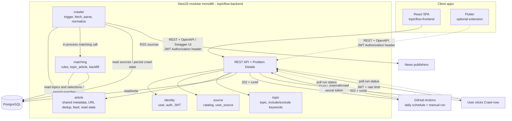

# TopicFlow (TFL) — Implementation Plan

> Portfolio project: a news aggregator organized by **topics** (include and exclude keywords), with optional news sources and read/unread tracking.
> - Jira key: **TFL**
> - Repo: `topicflow-backend` (NestJS + TypeScript + PostgreSQL), `topicflow-frontend` (React SPA/PWA), `topicflow-mobile` (Flutter)
> - The backend is intended as a hands-on architecture learning project; the frontend will be built primarily with AI-assisted coding.
> - The original Java/Spring/MySQL plan is preserved unchanged in `docs/blueprints/topicflow-blueprint-v1.md`.

---

## 1. Goals and scope

### 1.1 Goals
- Build and deploy a working product to showcase NestJS/TypeScript and PostgreSQL backend skills on a résumé. Follow the Lean route through a stable demo before optional extensions.
- Learn and demonstrate a modular monolith, type-safe data access, PostgreSQL query and transaction behavior, RSS ingestion, URL-level idempotency, matching, pagination, focused test layers, and CI. Add bounded concurrent crawling with a measured benchmark after the sequential crawler works.

### 1.2 MVP scope
- User registration and login (JWT).
- A news source catalog; users can select or deselect sources at any time.
- Topics: each topic can have multiple **INCLUDE** and **EXCLUDE** keywords; users can create multiple topics.
- Crawl daily on a schedule (GitHub Actions calls an endpoint); users can also click “Crawl now,” subject to rate limits. Store metadata only: title, snippet, original URL, thumbnail, publication time, and source. Users follow the link to read the article on the publisher’s site.
- Topic feeds with cursor pagination; opening an article launches its original page in an external browser.
- Read/unread controls: mark an article read or unread, or mark all articles in a topic as read.
- Users can delete their own topics. Lean does not promise per-article trash/restore or a 30-day purge; those independent deletion lifecycles are an extension. Shared article metadata is not deleted when a topic is removed.

### 1.3 Out of MVP (future work)
- Push notifications (FCM), alongside the Flutter phase; HTML parsers; Grafana; and PWA when time is limited.
- Elasticsearch, a separate crawling service, and a message queue (Kafka/RabbitMQ).
- Search, advanced ranking/recommendations, analytics, and LLM summaries. Section 13 retains the complete learning backlog and searchable keywords.

### 1.4 Decisions
| Decision                                                                                                              | Rationale                                                                                                                                        |
|-----------------------------------------------------------------------------------------------------------------------|--------------------------------------------------------------------------------------------------------------------------------------------------|
| NestJS modular monolith; keep one backend and one database                                                            | Less operational overhead, shared data, and no current scaling pressure                                                                          |
| Put the crawler behind an interface (port)                                                                            | Makes it easier to extract a standalone worker later                                                                                             |
| Crawl by **source**, not by user                                                                                      | Each source is crawled once and matched for all users                                                                                            |
| Use RSS for Lean; consider sitemaps and Cheerio for static HTML later                                                 | Finish and test one ingestion path before adding source-specific parsers                                                                         |
| GitHub Actions runs daily and calls an endpoint; “Crawl now” uses the same flow                                       | External triggering supports the free-tier demo; verify current hosting terms before deployment                                                  |
| Store metadata, snippets, and original links only                                                                     | Readers visit the publisher’s site; this limits storage and third-party content retained in the database                                         |
| Frontend: **minimal React SPA (Vite + TypeScript)**; PWA and Flutter are optional later phases                        | Provides an early demo link while keeping backend learning in focus                                                                              |
| Do not use Next.js or React Native                                                                                    | This is a personal feed behind login and does not need SSR/SEO; Flutter is already planned for phase 2                                           |
| Authenticate with JWT in headers, **not** browser cookies/sessions                                                    | The SPA and Flutter app share one authentication mechanism                                                                                       |
| Keep business logic (matching, read state, pagination) in the backend                                                 | Flutter only needs to reimplement the UI                                                                                                         |
| Use PostgreSQL as the primary relational database                                                                     | Topics, articles, selections, read state, and crawl state rely on relationships, joins, constraints, and transactions                            |
| Treat database traffic as read-heavy (working estimate: about 10:1 reads to writes), with bursty writes during crawls | Fan out matches into `topic_article` for straightforward feed reads; treat the ratio as an assumption to validate with synthetic-data load tests |
| Use a supported Node.js LTS, NestJS, TypeScript, and Prisma as the project baseline                                   | One coherent backend stack; verify exact compatible releases and deployment support in TFL-1 rather than pinning versions in this plan           |

---

## 2. Architecture



TypeScript root: `src/`, with one Nest module per domain (`identity`, `source`, `topic`, `crawler`, `article`, `matching`) and shared infrastructure kept outside domain modules.

### 2.1 Module boundaries
- Each module owns writes to its tables and exposes application services for business operations. This is a code convention with one shared `PrismaClient`: only a module's repository classes inject `PrismaService` to write its tables; controllers/application services call those repositories or exported application services. The `article` feed read model may use read-only SQL joins across `topic`, `article`, and `user_source`; document that exception in ADR-001. Import rules check TypeScript dependencies, not SQL joins.
- `crawler` calls the public `matching` application service after persisting new articles. An `ArticlesIngested` event is a later decoupling option; an in-process Nest event emitter does not provide durable delivery.
- Keep Nest module exports narrow. From TFL-2's first repository, add a scoped ESLint `no-restricted-imports` rule for controllers and application services so they cannot import `PrismaService`/generated Prisma Client directly; database infrastructure, repositories, and tests are exceptions. Review write ownership separately because static import rules cannot prove which table a query changes.

### 2.1.1 Architecture style by module
- Keep the overall application a modular monolith; choose the internal style based on each module's complexity, not for uniformity.
- `crawler`: use a small `Fetcher`/`SourceParser` boundary for HTTP and RSS; expand to ports and adapters (hexagonal architecture) if additional adapters justify it.
- `matching`: use a lightweight hexagonal boundary around pure matching rules so they can be tested without NestJS or a database.
- `identity`, `source`, and `topic`: use straightforward layered architecture while their workflows remain simple.
- `article`: use layered writes plus a focused feed/read model for read-heavy queries; this is CQRS-lite, not a separate service or a full CQRS framework.
- Keep pure matching and normalization independent of NestJS and Prisma. Record proportionate module choices in ADR-001; enforce dependency direction (`adapter → application → domain`) where that layering is actually used.

### 2.2 Crawl flow
1. GitHub Actions or a user calls the trigger. Atomically allow one active `crawl_run` system-wide; return `202` with its `runId`, or return the existing run/`409` according to the API contract. `202` means accepted, not completed.
2. An in-process async runner gets the active sources selected by at least one user. Bound its execution time and expose a status endpoint. The trigger must not hold a database transaction or row lock during network fetches. Keep CPU-heavy parsing off the event loop if measurement shows a problem.
3. For each source, fetch and parse RSS, decode entities and strip markup from title/description into plain text before matching, validate HTTP(S) links, canonicalize article URLs, calculate `url_hash`, insert only new articles with PostgreSQL conflict handling, and match them against active topics regardless of each user's current source selection. The feed applies source selection at read time. Count `new_articles` from rows actually inserted; count failed sources and retain a bounded `error_summary`. A failed source must not discard earlier successes.
4. At the end of **every** run, call `reconcile(topic, window)` for the last N days (initial choice: 30, measured by `article.created_at`): compute desired matches from all stored articles in the window regardless of source selection, insert missing `topic_article` associations, and delete associations in that window only when keyword rules no longer match. Deselecting a source retains its associations; selecting it again reveals them through the feed filter. Include URLs already stored before this run. Using ingestion time lets the next run repair a recently stored article even if its publisher date is old or missing. Leave `user_article_state` untouched.
5. GitHub Actions and the frontend poll by `runId` until terminal status or timeout. The next trigger can mark an abandoned active run failed after a documented timeout and start a fresh run. Unique URL constraints and idempotent topic-article writes make reruns safe; Lean does not resume an interrupted source from a checkpoint.
6. Mark the run `SUCCESS` when all sources and reconciliation succeed, `PARTIAL` when useful source work succeeds but a source or reconciliation fails, or `FAILED` when no source succeeds. With no eligible sources, succeed with zero counts only if reconciliation succeeds. The status endpoint returns `new_articles`, `failed_sources`, and `error_summary` with that state. Record useful logs with the run ID. A worker finalizes only its own RUNNING row and releases the lock only if `active_run_id` still equals its run ID; a stale worker cannot overwrite a newer run.

Lean guarantees URL-level deduplication and one active crawl under normal operation, with explicit abandoned-run handling. `reconcile(topic, window)` is the shared repair/backfill path for crawl runs and keyword changes; source selection is handled by the feed read filter. Articles older than N days retain their existing associations: a newly added EXCLUDE does not hide those older matches. Document this limit in the README/ADR; full-history batch reconciliation is an extension. Durable delivery, lease/heartbeat, per-source checkpoints, transactional outbox, and restart recovery belong to section 13.

### 2.3 Matching rules
- Normalize by lowercasing, removing Vietnamese diacritics, and collapsing whitespace. Match against `title + snippet`.
- An article matches a topic if **at least one INCLUDE** keyword matches and **no EXCLUDE** keyword matches.
- Match on **word boundaries** (so “ai” does not incorrectly match “mail” but does match the later standalone “ai” in “mail ai”); multi-word keywords match as phrases.
- When a user changes keywords, call `reconcile(topic, window)` over the last N days. Source selection does not delete `topic_article` associations: deselecting hides articles through the feed's `user_source` filter, while selecting again reveals retained matches without another crawl. Matches older than N days remain unchanged, including those that would fail newly added EXCLUDE rules.

---

## 3. Data model concept (PostgreSQL)

> **Planning sketch only — not the approved database design or executable DDL.**
> This section illustrates the entities and relationships currently expected by the product plan. The shown column types, checks, and indexes are candidates; finalized foreign keys, constraints, index design, and migration ordering belong to the relevant stories and may change as requirements are implemented.
> Treat each Prisma Migrate migration delivered with its Jira ticket as the authoritative database design. Review and refine the schema with the relevant domain behavior and integration tests before merging that migration. Handwritten SQL within those migrations is allowed for PostgreSQL features Prisma Schema cannot express. Do not execute or copy this sketch directly into a database.

```sql
CREATE TABLE users (
  id BIGINT GENERATED BY DEFAULT AS IDENTITY PRIMARY KEY,
  email VARCHAR(255) NOT NULL UNIQUE,
  password_hash VARCHAR(255) NOT NULL,
  created_at TIMESTAMPTZ NOT NULL
);

CREATE TABLE source (
  id BIGINT GENERATED BY DEFAULT AS IDENTITY PRIMARY KEY,
  name VARCHAR(120) NOT NULL,
  type VARCHAR(16) NOT NULL CHECK (type IN ('RSS')),
  url VARCHAR(500) NOT NULL,
  active BOOLEAN NOT NULL DEFAULT TRUE
);

CREATE TABLE user_source (
  user_id BIGINT NOT NULL,
  source_id BIGINT NOT NULL,
  PRIMARY KEY (user_id, source_id)
);

CREATE TABLE topic (
  id BIGINT GENERATED BY DEFAULT AS IDENTITY PRIMARY KEY,
  user_id BIGINT NOT NULL,
  name VARCHAR(120) NOT NULL,
  keywords_version INT NOT NULL DEFAULT 0,
  created_at TIMESTAMPTZ NOT NULL
);
CREATE INDEX idx_topic_user ON topic (user_id);

CREATE TABLE topic_keyword (
  id BIGINT GENERATED BY DEFAULT AS IDENTITY PRIMARY KEY,
  topic_id BIGINT NOT NULL,
  keyword VARCHAR(120) NOT NULL,
  normalized_keyword VARCHAR(120) NOT NULL,
  type VARCHAR(16) NOT NULL CHECK (type IN ('INCLUDE','EXCLUDE')),
  CONSTRAINT uq_topic_kw UNIQUE (topic_id, normalized_keyword, type)
);

CREATE TABLE article (
  id BIGINT GENERATED BY DEFAULT AS IDENTITY PRIMARY KEY,
  source_id BIGINT NOT NULL,
  url VARCHAR(1000) NOT NULL,
  url_hash CHAR(64) NOT NULL UNIQUE,      -- lowercase hex SHA-256 of the canonical URL
  title VARCHAR(500) NOT NULL,
  snippet VARCHAR(1000) NULL,
  thumbnail_url VARCHAR(1000) NULL,
  published_at TIMESTAMPTZ NULL,
  created_at TIMESTAMPTZ NOT NULL
);
CREATE INDEX idx_article_source_pub ON article (source_id, published_at);

CREATE TABLE topic_article (
  topic_id BIGINT NOT NULL,
  article_id BIGINT NOT NULL,
  matched_keywords VARCHAR(500) NULL,
  PRIMARY KEY (topic_id, article_id)
);
CREATE INDEX idx_ta_feed ON topic_article (topic_id, article_id DESC);

CREATE TABLE user_article_state (       -- a row means read; no row means unread
  user_id BIGINT NOT NULL,
  article_id BIGINT NOT NULL,
  read_at TIMESTAMPTZ NOT NULL,
  PRIMARY KEY (user_id, article_id)
);

CREATE TABLE crawl_run (
  id BIGINT GENERATED BY DEFAULT AS IDENTITY PRIMARY KEY,
  trigger_type VARCHAR(16) NOT NULL CHECK (trigger_type IN ('SCHEDULED','USER')),
  requested_by_user_id BIGINT NULL,
  status VARCHAR(16) NOT NULL CHECK (status IN ('QUEUED','RUNNING','SUCCESS','PARTIAL','FAILED')),
  new_articles INT NOT NULL DEFAULT 0,
  failed_sources INT NOT NULL DEFAULT 0,
  error_summary VARCHAR(500) NULL,
  created_at TIMESTAMPTZ NOT NULL,
  started_at TIMESTAMPTZ NULL,
  abandoned_after TIMESTAMPTZ NULL,
  finished_at TIMESTAMPTZ NULL
);
CREATE INDEX idx_crawl_run_active ON crawl_run (status, abandoned_after);

CREATE TABLE crawl_lock (
  id SMALLINT PRIMARY KEY,                 -- only row id=1 exists
  active_run_id BIGINT NULL
);
-- Seed one control row. crawl_run.abandoned_after is the only deadline; claim/release/takeover must be atomic.
```

Notes:
- Store timestamps in UTC as PostgreSQL `TIMESTAMPTZ`. Keep `BIGINT` IDs deliberately to learn the PostgreSQL/JavaScript boundary: Prisma maps them to JavaScript `bigint`, so serialize IDs and the article-ID cursor as decimal strings in JSON/OpenAPI. Reuse TFL-1's parse/serialize helpers and never pass raw `bigint` to `JSON.stringify`; TFL-2 and TFL-10 test their DTO boundaries.
- Canonical URLs: remove tracking parameters (`utm_*`, `fbclid`, etc.) and fragments, and normalize the scheme/host.
- Lean deletes a topic and its private keywords/associations; shared `article` metadata remains and active articles have no age-based retention limit. No per-article trash, restore, tombstone, or 30-day purge is promised. See section 13 for independent `topic.deleted_at` / `topic_article.deleted_at` lifecycles and `dismissed_at`.
- `crawl_run` holds status, result totals, a bounded error summary, and the sole `abandoned_after` deadline; `crawl_lock` stores only `active_run_id` to serialize claims. See section 2.2 for takeover semantics.
- The database unique constraint on `article.url_hash` is global and authoritative. Lean controls the catalog: seed at most one RSS feed per publisher and do not allow user-added sources. Overlapping URLs across catalog feeds can still be attributed only to the first stored `source_id`, so filtering by selected source may hide an otherwise relevant article; record this accepted limitation in the README/ADR. TFL-7 chooses and tests the insert/conflict API, counts `new_articles` only from inserted rows, and must not suppress unrelated constraint errors.
- `reconcile(topic, window)` evaluates keyword rules independently of `user_source`; source deselection retains associations and only the feed read filter hides them. It never changes `user_article_state`. See section 2.2; durable `ArticlesIngested` delivery with a transactional outbox is an extension.
- The Flutter phase will add a `device_token` table (`user_id`, `token`, `platform`) for push notifications.
- Add indexes as needed based on `EXPLAIN` results.

---

## 4. API (REST, mobile-first)

| Group          | Endpoint                                                        | Notes                                                                                                                     |
|----------------|-----------------------------------------------------------------|---------------------------------------------------------------------------------------------------------------------------|
| Auth           | `POST /auth/register`, `POST /auth/login`, `POST /auth/refresh` | JWT in the Authorization header                                                                                           |
| Sources        | `GET /sources`                                                  | Catalog with the user’s `selected` flag                                                                                   |
| Sources        | `PUT /me/sources`                                               | Replace the selected source list                                                                                          |
| Topics         | `GET/POST /topics`, `PUT/DELETE /topics/{id}`                   |                                                                                                                           |
| Topics         | `PUT /topics/{id}/keywords`                                     | Send `include[]` and `exclude[]`                                                                                          |
| Feed           | `GET /topics/{id}/articles?cursor=&limit=&unreadOnly=`          | Cursor pagination by `article.id`                                                                                         |
| Read state     | `PUT /articles/{id}/read`, `DELETE /articles/{id}/read`         | Mark read / unread                                                                                                        |
| Read state     | `POST /topics/{id}/read-all`                                    | Mark all as read                                                                                                          |
| Crawl          | `POST /crawl`                                                   | JWT; user-triggered crawl returns `202` + `runId`; rate-limited                                                           |
| Internal       | `POST /internal/crawl`                                          | Secret token for GitHub Actions; returns `202` + `runId` after persisting the request                                     |
| Internal       | `GET /internal/crawl-runs/{runId}`                              | GitHub Actions polls until the run is terminal or times out                                                               |
| Crawl          | `GET /crawl-runs/{runId}`                                       | User views status, `new_articles`, `failed_sources`, and `error_summary` for their run                                    |
| Topic deletion | `DELETE /topics/{id}`                                           | Lean: owner deletes a topic; its private keywords/matches are removed, shared article metadata remains                    |
| Ops            | `GET /health`                                                   | NestJS health endpoint used by Render                                                                                     |
| API docs       | `/docs`, `/docs/json`, JSON spec                                | NestJS Swagger UI and OpenAPI JSON; expose publicly only if configured safely, otherwise protect or disable in production |

Conventions: return errors in a consistent RFC 7807 Problem Details format. Keep feed responses concise (`id`, `title`, `snippet`, `thumbnail`, `source`, `publishedAt`, `isRead`, `url`). Configure CORS with an explicit allowlist for the SPA (and Flutter web, if used).
Represent `BIGINT` IDs and cursor tokens as strings in JSON/OpenAPI; convert and validate them at the API boundary.

---

## 5. Hosting

> Render details are based on third-party documentation available when this plan was drafted (October 2026). **Verify current terms before deployment.**

**Backend (Render Free)**
- A Free Web Service sleeps after 15 minutes without requests and takes about one minute to cold-start. Each workspace gets 750 free instance hours per month.
- Free Web Services have no persistent disk and cannot run one-off jobs.
- A Free Web Service cannot use Render's paid-only pre-deploy command; TFL-19 defines the startup migration path and must recheck current plan terms.
- Render's free PostgreSQL database expires after 30 days and has no free-plan backups. Choose a durable PostgreSQL host or paid plan for a lasting demo; if using the free database, document reseeding/export and its expiry.
- Strategy: use an external scheduler to wake the service (start with once daily; increase to 4–6 times per day if needed). **Do not** send continuous keep-alive pings.
- GitHub Actions calls the endpoint daily and can also be run manually. Verify the current Render Cron price before choosing it for a zero-cost demo.
- GitHub Actions and the Crawl Now button use the trigger/status contract in section 2.2. Deployment must document that background work may be interrupted by a host restart and that completion is not guaranteed while the host is asleep.
- Keep a local demo procedure and short video/GIF as a fallback when cold starts, database expiry, free-tier availability, or GitHub Actions scheduling make the live link unreliable.

**Frontend**
- Build the SPA as static files and host it on a static hosting service (Vercel, Netlify, Cloudflare Pages, etc.; verify current free tiers). Static hosting does not have the backend’s cold start.
- Show a waiting state when the first API call wakes the backend; measure the actual cold start instead of promising a fixed delay.

---

## 6. TypeScript/NestJS baseline, features, and design patterns (tied to real use cases)

Use a **supported Node.js LTS + NestJS + TypeScript + Prisma + PostgreSQL** combination. TFL-1 verifies compatible exact versions of Nest core/platform, `@nestjs/swagger`, the chosen JWT package, Prisma Client/Migrate, test runner, Node runtime, container image, and deployment host before implementation; record the selected versions in the README/ADR. Use strict TypeScript settings and validated runtime configuration. Keep PostgreSQL migrations in Prisma Migrate, with handwritten SQL in a migration when a constraint, index, or atomic statement needs it. Do not assume TypeScript types validate untrusted HTTP input. Keep network fetches asynchronous and database transactions short; measure event-loop delay before introducing worker threads.

| Concept                                    | Where it is used                                                                                                | Interview discussion point                                         |
|--------------------------------------------|-----------------------------------------------------------------------------------------------------------------|--------------------------------------------------------------------|
| Bounded async concurrency                  | After the sequential RSS flow is stable, fetch multiple sources with a concurrency limit and per-domain limiter | I/O-bound work, rate limits, cancellation, and measured throughput |
| `async`/`await`, `Promise.allSettled`      | Fetch independent sources and preserve partial outcomes; avoid an unbounded `Promise.all`                       | Failure isolation and backpressure                                 |
| Discriminated unions and exhaustive checks | `CrawlResult = Success \| Failed \| Skipped`                                                                    | Model states safely in TypeScript                                  |
| Strategy + Registry/Factory                | Extension: select an RSS or HTML `SourceParser` by `source.type`                                                | Add sources without modifying existing code (OCP)                  |
| Template Method or composition             | Extension: shared fetch → parse → map flow                                                                      | Reuse steps without unnecessary inheritance                        |
| Decorator                                  | Extension: wrap `Fetcher` with retries, rate limits, and robots.txt checks                                      | Add behavior without changing the original class                   |
| Chain of Responsibility / Pipeline         | Filtering steps: deduplicate → include → exclude                                                                | Keep steps separate and easy to add/remove                         |
| Specification                              | Represent topic-matching rules                                                                                  | Compose and test rules independently                               |
| Observer / Domain event                    | Extension: `ArticlesIngested` → matching; Lean calls a service directly                                         | Reduce coupling; distinguish in-process events from durable work   |
| Ports & Adapters                           | Use full ports and adapters in `crawler`, lightweight boundaries in `matching`                                  | Match architecture weight to module complexity                     |

Note: use a pattern only when it solves a concrete problem, and record the rationale in an ADR.

---

## 7. Time estimates

Assumption: one focused workday is about 4–5 hours. Estimates are planning ranges, not deadlines; add 15–25% contingency for integration, RSS instability, and deployment. Frontend time is separate.

| Route                   | Ordered outcome                                                                                                                 | Backend target                                                                                    | Frontend                                                      |
|-------------------------|---------------------------------------------------------------------------------------------------------------------------------|---------------------------------------------------------------------------------------------------|---------------------------------------------------------------|
| **Lean core**           | Follow TFL-1…TFL-25 in order; backend stories are TFL-1…13, TFL-17…20, and TFL-25; frontend stories are TFL-14…16 and TFL-21…24 | **~90–120 hours before contingency**; re-estimate after TFL-7/10 with reconciliation measurements | Minimal TFL-14…16 and TFL-21…24: **~15–25 hours**, separately |
| **Lean highlight**      | Once the sequential crawler and demo work, TFL-26 bounded async concurrency + measured benchmark                                | **~8–15 additional hours**                                                                        | No new frontend requirement                                   |
| **CV-grade extensions** | Choose TFL-27…TFL-34 and section 13 only for a concrete learning or product reason                                              | Re-estimate each slice after Lean; the old 106–156 hour aggregate is withdrawn                    | PWA/Flutter separate                                          |

At 4–5 focused hours/day, Lean core is roughly 5–8 weeks including ordinary interruptions; re-estimate after TFL-3 and TFL-10 because the new stack may change setup and query work. The benchmark and contingency extend that. Do not compress PostgreSQL/query work, test layers, README, or demo to meet a round number.

---

## 8. Detailed Jira story plan

How to read this section:
- TFL-1…TFL-38 are the canonical task numbers **in execution order**; never zero-pad them. [BE], [FE], and [Mobile] identify repository/scope. Keep each PR independently reviewable; cross-repository stories use one linked PR per repository (section 9). Checkboxes are subtasks.
- **Lean execution order:** complete TFL-1…TFL-25 in the order they appear below. React TFL-14…16 start after the TFL-13 API contract; React TFL-21…24 follow backend TFL-17…20. In particular, TFL-21 waits for TFL-20 and TFL-23 waits for TFL-18. Frontend work therefore begins before backend completion.
- After the Lean demo, TFL-26 is the optional highlight, TFL-27…34 are optional CV-grade stories, and TFL-35…38 are optional Mobile stories. Follow numeric order for the stories you choose; skip unchosen optional stories without renumbering the rest.
- Tests for a feature belong in that feature's PR. TFL-12 adds focused cross-slice coverage without postponing ordinary feature tests.
- An optional deployment smoke check after TFL-3 or TFL-4 can expose Render/PostgreSQL hosting risks early; the full scheduler, status polling, and deployment work remain in TFL-19.

### P0 — Foundation (topicflow-backend)

**TFL-1 [BE] — Foundation + minimal CI**
- [x] **First:** verify compatible exact Node.js LTS, NestJS, `@nestjs/swagger`, JWT package, Prisma, PostgreSQL driver/adapter, and test-runner releases; build a minimal Swagger UI + JWT smoke test before committing to the baseline
- [x] Repository, `.gitignore`, license, and README skeleton
- [x] Verify exact versions of Nest core/platform, TypeScript, Prisma Client/Migrate, `@nestjs/swagger`, JWT package, test runner, Testcontainers, CI Node version, Docker base image, and deployment runtime
- [x] Choose one package manager/lockfile and strict TypeScript settings; record any compatibility fallback in an ADR
- [x] Nest CLI scaffold and domain-module folder structure
- [x] Docker Compose for local PostgreSQL
- [x] Prisma schema and initial Prisma Migrate baseline; establish how handwritten SQL migrations are reviewed
- [x] `local` / `prod` environment configuration with runtime validation and no committed secrets
- [x] Shared exception filter for consistent RFC 7807 Problem Details; global validation pipe for request DTOs
- [x] Decide and test decimal-string JSON serialization/validation for PostgreSQL `BIGINT` IDs and cursors
- [x] Add `@nestjs/swagger` and Swagger UI for local/dev; document each endpoint in its feature PR
- [x] Basic GitHub Actions CI: build and run unit tests on every PR/push; cache dependencies
- [x] No PostgreSQL in CI yet; add a Testcontainers/PostgreSQL integration stage in TFL-3 after TFL-2 adds the first migration and tests
- [x] A small TypeScript import/Nest module-boundary check if it protects a real boundary; otherwise track it in section 13
- [x] ADR-001: modular monolith, module-owned writes, the feed's read-only cross-module SQL joins, and TypeScript import/Nest module boundaries
- [x] Record the Node.js/NestJS/Prisma compatibility choice in the README or a short ADR

**TFL-2 [BE] — Auth & users**
- [ ] `users` Prisma schema and migration; reuse TFL-1's decimal-string `BIGINT` ID helper in request/response DTOs and test IDs beyond JavaScript's safe-integer range
- [ ] First `identity` repository owns user-table writes and is the only identity class that injects `PrismaService`; add a scoped ESLint `no-restricted-imports` rule barring direct Prisma imports in controllers/application services, then extend it as repositories appear in other modules
- [ ] Registration/login and password hashing (BCrypt/Argon2)
- [ ] JWT access and refresh tokens in headers; Nest guard and ownership checks; define refresh-token storage/rotation or a documented minimal revocation limit
- [ ] Set up a reusable PostgreSQL Testcontainers helper for later PRs
- [ ] Set a basic login-attempt limit; document its in-process/free-tier limits
- [ ] Tests: duplicate email registration, wrong password, expired token

**TFL-3 [BE] — CI integration-test profile** *(after TFL-2, before TFL-4)*
- [ ] Separate unit, database integration, and HTTP e2e tests using test scripts/tags
- [ ] CI starts PostgreSQL Testcontainers, applies Prisma migrations, and executes integration tests
- [ ] Retain logs/test reports on failure; do not store secrets or real data in artifacts

### P1 — Core domain

**TFL-4 [BE] — Sources**
- [ ] `source` and `user_source` Prisma schema/migrations
- [ ] Seed 5–10 stable RSS sources, at most one feed per publisher; users select from the catalog but cannot add feeds in Lean
- [ ] `GET /sources` with the user’s `selected` flag
- [ ] `PUT /me/sources` (users can add/remove sources at any time)
- [ ] API authorization tests and one Nest `TestingModule` + Supertest HTTP test for selected-source validation

**TFL-5 [BE] — Topics & keywords**
- [ ] `topic` and `topic_keyword` Prisma schema/migrations, including `topic.keywords_version INT NOT NULL DEFAULT 0`
- [ ] Create `topic_keyword.topic_id` foreign key with `ON DELETE CASCADE` in the initial migration so deleting a topic cannot leave orphan keywords
- [ ] `TextNormalizer` for both RSS text and user keywords: normalize canonical Unicode forms with `NFD`, lowercase, replace `đ`/`Đ` with `d`, remove combining marks, and collapse whitespace without dropping meaningful punctuation; test composed NFC versus decomposed NFD input, upper/lowercase `Đ`/`đ`, and equivalent results
- [ ] Topic CRUD (verify ownership)
- [ ] `PUT /topics/{id}/keywords` with include/exclude keywords and duplicate prevention; replace the keyword set and increment `topic.keywords_version` atomically in the same transaction, including changes to an empty set
- [ ] Per-user topic/keyword limits
- [ ] Validation and cross-user ownership tests using Nest `TestingModule` + Supertest where suitable

*(If TFL-5 exceeds about 8 hours, split “topic CRUD” and “keywords + TextNormalizer” into two PRs.)*

### P2 — Vertical crawler slice

**TFL-6 [BE] — Fetch & parse (pure logic, no database yet)**
- [ ] `Fetcher` and `SourceParser` interfaces (ports)
- [ ] `HttpFetcher` (timeouts, User-Agent, response-size limit)
- [ ] `RssParser` → typed `ParsedArticle` interface/value object
- [ ] Decode RSS HTML entities (`&amp;`, `&nbsp;`) and strip HTML from title/description with a real HTML parser (discard `script`/`style` content too), yielding plain text before `TextNormalizer` or matching; normalize whitespace and truncate the resulting title to 500 and snippet to 1000 characters without splitting a Unicode code point
- [ ] Resolve relative article/thumbnail URLs against the feed URL if supported, then accept only `http:`/`https:` via URL parsing: skip an article with an invalid/unsafe link and omit an invalid/unsafe thumbnail. Canonicalize and hash only a validated article link
- [ ] Canonicalize URLs and calculate `url_hash`
- [ ] Test the parser with a saved real-world RSS fixture plus markup/entity, NFC/NFD, overlength, and `javascript:`/`data:` URL cases; ensure markup words such as `img`/`style` cannot become matching text; test URL canonicalization

**TFL-7 [BE] — Persist articles & run crawls**
- [ ] Migrate `article` and the minimal crawl state needed by TFL-18 with Prisma Migrate; defer `crawl_source_result` and `outbox_event`
- [ ] `crawl_run` stores `new_articles`, `failed_sources`, and bounded `error_summary` as well as status; `crawl_lock` stores only `active_run_id`, with `crawl_run.abandoned_after` as the sole deadline
- [ ] Persist articles using unique `url_hash`; first verify Prisma 7.10.1 `createManyAndReturn({ skipDuplicates: true })` on PostgreSQL, count `new_articles` from returned rows, and do not assume return order. It skips any unique conflict: use targeted parameterized PostgreSQL `ON CONFLICT (url_hash) DO NOTHING RETURNING id` if another unique constraint could be violated. Cover duplicates already in the DB and within one batch ([Prisma 7 Client reference](https://www.prisma.io/docs/orm/v7/reference/prisma-client-reference))
- [ ] Keep global URL deduplication and one `source_id` per article; document the catalog overlap/source-attribution limit in the README/ADR rather than silently claiming all cross-source cases work
- [ ] Orchestrator crawls selected RSS sources sequentially and records source errors and run totals
- [ ] Internal runner/CLI to test one source end-to-end
- [ ] Integration test: two runs do not create duplicates (idempotency)

### P3 — Matching, feed, test slices, and API contract

**TFL-8 [BE] — Matching rules (pure logic)**
- [ ] Specification: at least one INCLUDE and no EXCLUDE match
- [ ] Match literal normalized keywords/phrases by iterating **every** `indexOf` occurrence, advancing past a failed boundary candidate; test neighboring Unicode letters/numbers with `\p{L}`/`\p{N}` and the `u` flag. Do not feed user input directly to `RegExp` or rely on ASCII `\b`. If regex is chosen, verify `RegExp.escape` runtime/TypeScript-lib support (or use a vetted escape helper) and use Unicode-aware lookaround with a fixed pattern to avoid regex injection/ReDoS
- [ ] Table-driven tests (Vietnamese diacritics, short words, `mail ai` matching `ai` only at the second occurrence, duplicates, exclude overrides include, phrases, `c++`, `.net`, `covid-19`, regex metacharacters, and punctuation next to a match)

**TFL-9 [BE] — Connect matching to ingestion**
- [ ] `topic_article` Prisma schema/migration, including `topic_article.topic_id` foreign key with `ON DELETE CASCADE` from the start so TFL-5's topic deletion cannot leave orphan matches
- [ ] Public matching service applies keyword rules to new articles for all active topics, independently of `user_source`, and idempotently writes `topic_article`; call it from ingestion
- [ ] Implement `reconcile(topic, window)` for the last N days: compute keyword matches independently of source selection, insert missing associations, and delete only those that fail keyword rules in that window; leave `user_article_state` unchanged. Page through the complete bounded window and write in small batches with short transactions; never silently truncate reconciliation at a row limit
- [ ] Set explicit Prisma interactive-transaction `maxWait`/`timeout` for each bounded write batch and size the `pg` pool against the database host's connection limit. Prisma 7 defaults are `maxWait = 2 s`, `timeout = 5 s`, and the `pg` adapter pool defaults to `max = 10` per process; verify these for pinned 7.10.1 during implementation. Do no network fetch or full-window scan inside a write transaction. Measure batch duration and document retry/failure behavior ([Prisma transaction options](https://www.prisma.io/docs/orm/v7/reference/prisma-client-reference), [pool defaults](https://www.prisma.io/docs/orm/v7/prisma-client/setup-and-configuration/databases-connections/connection-pool))
- [ ] Capture `topic.keywords_version` with the keyword snapshot at reconcile start. For **every** `topic_article` write batch (including direct matching of new articles), use a short transaction that locks the topic row with parameterized `SELECT ... FOR UPDATE`, verifies the version **inside the same transaction**, then writes. A changed version aborts that topic and restarts with fresh keywords; never commit a stale batch. Keep a bounded retry policy and surface unfinished work if keywords keep changing. Do not use a session advisory lock across Prisma pooled connections. Test an interleaved keyword update between batches: an older run cannot restore stale associations
- [ ] Expose reconciliation for TFL-18 to call at the end of **every** crawl, including URLs already stored; TFL-17 calls the same function after keyword changes
- [ ] End-to-end integration test: crawl a fixture and verify the article appears in the correct topic
- [ ] ADR: explain fan-out into `topic_article` for cheap feed reads, retaining associations across source deselection, filtering against `user_source` at read time, write amplification, catalog overlap/source attribution, and the N-day reconciliation limit

**TFL-10 [BE] — Feed & read state**
- [ ] `user_article_state` Prisma schema/migration
- [ ] `GET /topics/{id}/articles` with cursor pagination, `unreadOnly`, and `isRead`
- [ ] Filter by the owner's current `user_source` selection at read time so deselected sources disappear without deleting shared articles; cover this in the feed query and ADR from TFL-9
- [ ] `PUT/DELETE /articles/{id}/read`
- [ ] `POST /topics/{id}/read-all`
- [ ] Check `EXPLAIN` and add necessary indexes; TFL-11 measures the resulting query shape
- [ ] Treat `(topic_id, article_id DESC)` as an index candidate; validate ordering and additional predicates against actual queries with `EXPLAIN`
- [ ] Test pagination for gaps/duplicates when new articles arrive
- [ ] Update Nest OpenAPI decorators and DTOs for feed/read endpoints

**TFL-11 [BE] — Measure and fix feed query amplification (Lean core; after TFL-10)**
- [ ] Seed representative topics, articles, source selections, and read states; capture Prisma/SQL query count for feed pages of different sizes
- [ ] Fix any per-article N+1 queries with a batched relation load, focused projection, or parameterized read-only SQL query; keep pagination in the database
- [ ] Verify cursor order, ownership, `isRead`, and page-size-independent query count with a PostgreSQL integration test; inspect actual SQL and `EXPLAIN (ANALYZE, BUFFERS)` on representative data
- [ ] Document transaction scope, relation-loading choices, index rationale, and observed before/after measurements

**TFL-12 [BE] — Focused test slices (Lean core; after TFL-11)**
- [ ] Add PostgreSQL Testcontainers repository/query tests for feed joins, ownership/selection, and unique URL constraints; apply real Prisma migrations
- [ ] Add Nest `TestingModule` + Supertest HTTP tests for validation, unauthorized/forbidden access, and Problem Details; keep pure matching/`TextNormalizer` as unit tests
- [ ] Keep a few full integration tests for RSS → article → matching → feed and repeat-crawl idempotency; document the purpose of each test layer

**TFL-13 [BE] — Export the OpenAPI JSON contract** *(M1: feed API and JSON contract are ready; frontend can start)*
- [ ] Review APIs from auth through feed: requests/responses, JWT bearer auth, string-encoded `BIGINT` IDs/cursors, pagination, Problem Details, and error responses
- [ ] Export a stable `docs/openapi.json` using a repeatable task/script; update it in the same PR whenever the API contract changes
- [ ] Treat this as the first usable contract, not a freeze: TFL-18 and TFL-20 update the spec with their endpoints before TFL-23 and TFL-21 integrate them
- [ ] CI generates the spec through Nest Swagger and verifies it matches the committed file
- [ ] Ensure the spec has clear names/types for clean TypeScript and Dart client generation
- [ ] Keep Nest Swagger UI in local/dev; disable or protect it in production

### P4 — React foundation (after TFL-13)

**TFL-14 [FE] — Scaffold**
- [ ] Vite + React + TypeScript, lint/formatting, and CI build
- [ ] Generate a TypeScript client from `openapi.json`
- [ ] Environment configuration (API URL) and mobile-first layout

**TFL-15 [FE] — Auth**
- [ ] Login/registration screens
- [ ] Store tokens, refresh automatically, and guard routes

**TFL-16 [FE] — Source selection**
- [ ] Source list with select/deselect controls

### P5 — Backend completion

**TFL-17 [BE] — Reconcile after keyword changes & source visibility**
- [ ] Call TFL-9's `reconcile(topic, window)` when keywords change; source selection only changes feed visibility, while the next crawl ingests a source that no user had previously selected
- [ ] Tests: adding a keyword surfaces an article within N days; removing an INCLUDE or adding an EXCLUDE removes a now-invalid association; deselecting hides an article while retaining its association and re-selecting shows it without a new crawl; an article older than N days remains unchanged
- [ ] Bound reconciliation by the time window (initial N = 30 days by `article.created_at`) and page through **all** rows inside it with bounded page/batch sizes, without a silent total-row cutoff. Do not recreate associations for deleted topics; state in README/ADR that new EXCLUDE rules do not affect older matches
- [ ] Reuse TFL-9's paged reconciliation, `keywords_version` guard, and explicit transaction limits after keyword changes; if a batch fails or an execution budget is exceeded, surface incomplete work and continue/retry rather than leaving stale associations silently

**TFL-18 [BE] — Crawl triggers**
- [ ] Trigger creates a `crawl_run`, atomically claims the one active slot in a short PostgreSQL transaction, and returns `202` + `runId`; define existing-run/`409` behavior
- [ ] In-process async runner starts only after the claim commits, runs with a deadline and cancellation signal, and does not hold a transaction/row lock during network fetches
- [ ] Invoke TFL-9's `reconcile(topic, window)` at the end of every run; use the outcome rules in section 2.2
- [ ] Persist `new_articles`, `failed_sources`, and bounded `error_summary`; `SUCCESS`/`PARTIAL`/`FAILED` and the status endpoint reflect actual outcomes
- [ ] Finalize with a conditional parameterized update such as `UPDATE crawl_run ... WHERE id = $1 AND status = 'RUNNING'`; a current worker expects one affected row, while a stale worker with zero rows exits without releasing `crawl_lock`. Release the lock only where `active_run_id = $1` so an old worker cannot alter a newer run
- [ ] Provide the status endpoint for GitHub Actions/frontend polling and rate-limit user triggers
- [ ] Test duplicate requests, abandoned-run takeover, repeated/concurrent deduplication, partial source failure, and a simulated crash after article insert but before matching followed by a repair run
- [ ] Measure reconciliation time and SQL/query volume for representative numbers of topics, articles in the 30-day window, and keywords; record the demo-scale result

**TFL-19 [BE] — Deploy the backend**
- [ ] Multi-stage Dockerfile and health check
- [ ] `prod` configuration; secrets from environment variables
- [ ] Choose a durable PostgreSQL host/plan and configure a secure connection, connection limit, migration step, and backup or reseed procedure; if using Render Free Postgres, document its 30-day expiry
- [ ] On Render Free, use one Docker web-service instance and an entrypoint/start command that runs `prisma migrate deploy` before Nest; include the Prisma CLI in the final image, exit on migration failure, and verify repeated cold starts and a restart against an already migrated database. Keep schema changes backward-compatible with any old instance during deployment. Render's pre-deploy command is paid-only; recheck current plan terms before deployment ([Render deploy steps](https://render.com/docs/deploys))
- [ ] Deploy to Render
- [ ] Daily GitHub Actions `schedule` calls the internal endpoint using a secret stored in Actions Secrets; support manual workflow runs
- [ ] Workflow polls the status endpoint until terminal status/timeout; report an incomplete run rather than claiming durable completion
- [ ] Expose and document the user-authenticated crawl endpoint for the later TFL-23 button; keep user-trigger rate limiting in TFL-18
- [ ] Structured logs and a correlation ID for each crawl run
- [ ] Monitor workspace instance hours and bandwidth; daily scheduling is a starting point, not a guarantee that other workspace traffic will stay within the free allowance
- [ ] Document deployment and local demo/video fallback in the README; verify current host pricing, free-tier behavior, and scheduler limits at deployment time

**TFL-20 [BE] — Delete topics and articles within topics**
- [ ] Lean: delete an owned topic and its private keywords/associations; leave shared article metadata and other users' topics intact
- [ ] Verify the cascade foreign keys introduced in TFL-5 and TFL-9; reconciliation must skip a topic deleted during its run and never leave orphan associations
- [ ] Feeds and reconciliation must not show or recreate associations for a deleted topic
- [ ] Test ownership, cascade/transaction behavior, shared article preservation, and the delete-topic versus reconciliation race
- [ ] Keep per-article hide/delete, soft-delete, independent trash/restore, tombstone `dismissed_at`, and 30-day purge in section 13 as an explicit extension

### P6 — React completion

**TFL-21 [FE] — Topics & keywords**
- [ ] List, create, and edit topics; manage include/exclude keywords
- [ ] Delete an owned topic with confirmation; trash/restore UI is an extension
- [ ] Integrate the Lean TFL-20 API; update the generated client after the backend OpenAPI contract is merged

**TFL-22 [FE] — Feed & read state**
- [ ] Topic feed with cursor-based infinite scrolling
- [ ] Render title and snippet as plain text nodes, never as HTML (`innerHTML`/`dangerouslySetInnerHTML`); treat RSS-derived fields as untrusted even after backend cleanup
- [ ] Open article links in a browser; mark read/unread; mark all as read
- [ ] Per-article trash/restore and dismissal UI is an extension; keep the Lean feed focused on read state
- [ ] Filter to unread articles only

**TFL-23 [FE] — States & user experience**
- [ ] Loading/error/empty states on every screen
- [ ] “Crawl now” button calls the user-authenticated TFL-18 endpoint, shows crawl status, and polls by `runId`
- [ ] Waiting screen while the backend cold-starts; use measured host behavior rather than a guaranteed delay
- [ ] Check responsive layout on narrow screens

**TFL-24 [FE] — Deploy the frontend**
- [ ] Build static assets and deploy to static hosting
- [ ] Open a separate `topicflow-backend` PR to allow the deployed frontend origin in CORS; merge and deploy it before verifying the public frontend
- [ ] Open the `topicflow-frontend` deployment PR and verify API requests from the deployed domain

### P7 — Documentation and demo

**TFL-25 [BE] — Documentation & quality** *(Lean core: demonstrable portfolio package)*
- [ ] README: goals, local setup, deployment, sample account/data, API link, AI-assisted frontend ownership, and known limits (N-day keyword changes and overlapping catalog URLs)
- [ ] Architecture and crawl-flow diagrams; short video/GIF and live link or local demo fallback
- [ ] 2–3 short ADRs, including ADR-001's module/read-model boundary and TFL-9's fan-out/read-filter, association retention on source deselection, catalog overlap, and N-day reconciliation decisions
- [ ] CI badge and test-coverage report **(CV)**
- [ ] Clean up code/naming and resolve TODOs or create tickets for them

### P8 — Optional highlight and extensions

#### Lean highlight (after the demo)

**TFL-26 [BE] — Bounded concurrent crawling** **(Lean highlight; optional after core)**
- [ ] Add bounded async source concurrency plus per-domain limits; use `Promise.allSettled` or an equivalent pool so one failed source does not cancel others
- [ ] Propagate timeouts/cancellation, avoid blocking the Node.js event loop, and verify safe concurrent PostgreSQL writes (correct deduplication, no deadlocks)
- [ ] Benchmark the same N sources sequentially versus bounded concurrency at several limits; record articles/second, wall time, failure rate, memory, and event-loop delay in `docs/`
- [ ] ADR

#### Other CV-grade work

**TFL-27 [BE] — Refactor Strategy/Template (no behavior change)** **(CV)**
- [ ] Registry selects a parser by `source.type` (Strategy + Factory)
- [ ] Template Method or composition for the fetch → parse → map flow, only if it simplifies the code
- [ ] Model `CrawlResult` as a TypeScript discriminated union with exhaustive handling
- [ ] Existing tests continue to pass unchanged
- [ ] ADR explains the rationale

**TFL-28 [BE] — Fetch resilience** **(CV)**
- [ ] Decorators for retries (backoff), per-domain rate limits, and robots.txt checks
- [ ] Add `source.consecutive_failures` and `source.last_crawled_at` in this story's migration; temporarily disable repeatedly failing sources
- [ ] Test each decorator (simulate errors/timeouts)

**TFL-29 [BE] — HTML parser (Cheerio)** **(CV)**
- [ ] Configure `HtmlParser` selectors via `parser_config` for 1–2 sources
- [ ] Real-world HTML fixtures and parser tests
- [ ] Document the risk of parsers breaking when a source changes its structure

**TFL-30 [BE] — Crawl observability** **(CV; after M3)**
- [ ] OpenTelemetry/Prometheus-compatible metrics and Nest health checks for crawl duration, source success/failure, new articles, retries, and active/queued runs; avoid high-cardinality labels such as URL or user ID
- [ ] Minimal Grafana dashboard and alerts for repeated crawl failures or missed scheduled runs
- [ ] Document metric meaning, dashboard setup, and alert thresholds

**TFL-31 [BE] — Feed load test** **(CV; after M3)**
- [ ] Generate a reproducible synthetic dataset representing documented topic/article/read-state volumes
- [ ] Use k6 to exercise feed pagination and read filters; record p50/p95/p99 latency and test environment
- [ ] Use the measurements to validate read-heavy assumptions and revisit indexes only when the evidence supports a change

**TFL-32 [BE] — Near-duplicate article detection** **(CV; after observability)**
- [ ] Calculate SimHash fingerprints from normalized titles/snippets while preserving each publisher article and URL
- [ ] Generate candidate groups without automatically hiding or merging articles initially
- [ ] Evaluate precision/recall on a labeled sample before enabling automatic grouping

**TFL-33 [BE] — Extract crawl worker and queue** **(CV; only after measured need)**
- [ ] Record the operational/load reason for extraction and compare it with the in-process async runner
- [ ] Add a queue, retry policy, dead-letter handling, idempotent consumers, and worker metrics
- [ ] Keep source fetches, database transactions, and event delivery independently observable

**TFL-34 [FE] — PWA** **(CV; optional)**
- [ ] Manifest + service worker; “add to home screen” support
- [ ] Add demo screenshots/GIF to the README

#### Flutter and push (optional; after the chosen extensions)

**TFL-35 [Mobile] — Scaffold**: Flutter project, CI, and Dart client generated from `openapi.json`.

**TFL-36 [Mobile] — Auth**: login/registration, secure token storage, and automatic refresh.

**TFL-37 [Mobile] — Sources & topics**: select sources, topics, and keywords.

**TFL-38 [Mobile] — Feed & read state**: cursor-based feed, open links, mark read/unread.
**Push (paired PRs, in order)**:
- [ ] `topicflow-backend`: `device_token` table, token registration API, and FCM delivery for new topic matches *(merge + deploy first)*
- [ ] `topicflow-mobile`: register tokens, receive notifications, and open articles from them
- [ ] Daily email digest (separate from FCM): user opt-in, schedule, duplicate-send prevention, and email-provider configuration

---

## 9. Branch and PR rules

1. **One Jira story normally maps to one PR / one independently mergeable slice.** A cross-repository story such as TFL-24 uses one linked PR per repository; merge the backend CORS PR before verifying the frontend deployment. `main` must always build and run.
2. Keep these changes in the **same PR**:
   - migration + Prisma model/data-access code for that table;
   - endpoint + validation + tests + OpenAPI updates;
   - architecture decision + its ADR;
   - utilities used only by that slice (e.g. `TextNormalizer` with the keyword PR).
3. **Use separate PRs for:**
   - behavior-preserving refactors (TFL-27), separate from new features;
   - pure logic (parsing, matching rules) separate from persistence/wiring when substantial;
   - infrastructure (CI, Docker, deployment, cron) separate from business logic;
   - separate repositories use separate PRs.
4. **Size:** target 3–8 hours of work and fewer than ~400–500 changed lines (excluding generated files, seeds, and fixtures). Split larger changes along *pure logic → persistence → API* boundaries.
5. **Cross-repository contract:** merge the backend PR and update `openapi.json` **first**; frontend/mobile then regenerate their clients in their own PRs. Do not change the API and its client in the same PR when repositories are separate.
6. **Jira:** each `TFL-n` heading is a story; do not zero-pad the numeric ID. Use the same key in each PR title and link the story. Checkboxes are subtasks. Close the story when all its PRs are merged and meet the Definition of Done.
7. **Definition of Done for each PR:**
   - [ ] Build and tests pass in CI
   - [ ] Migration runs against an empty database
   - [ ] OpenAPI matches the code (when APIs change); CI checks that the JSON spec is not stale
   - [ ] README/ADR updated for new decisions
   - [ ] No TODOs without a tracking ticket

---

## 10. Résumé-ready checklist

**Project Definition of Done:** the main user journey works locally and on the demo link or video; CI passes targeted unit/slice/integration tests; repeat crawling does not duplicate articles; the feed query has measured SQL behavior; the README and ADRs let another developer run the app and understand its limits; and you can explain the tradeoffs yourself.

- [ ] Working demo link and a short video/GIF; local demo procedure if cloud cold starts or availability interrupt the link
- [ ] README: goals, architecture, local setup, deployment, known limits, and demo steps
- [ ] Architecture and crawl-flow diagrams; 2–3 short ADRs explaining decisions actually made
- [ ] Green CI with pure unit tests, Nest `TestingModule`/Supertest HTTP tests, and a few PostgreSQL Testcontainers integration tests
- [ ] Measured feed SQL count/query amplification before and after; benchmark sequential versus bounded async source crawling if TFL-26 is completed. Feed p95 and articles/second are optional load-test evidence.
- [ ] Swagger UI available in an appropriate environment; `docs/openapi.json` is versioned and checked by CI
- [ ] State that the frontend is a demo layer (AI-assisted); the focus is the backend
- [ ] Explain ownership, Prisma/PostgreSQL queries and transactions, deduplication, idempotency, matching, trigger failure limits, Node.js event-loop behavior, and any measured concurrency result; be ready to describe the AI-assisted frontend's API integration

---

## 11. Risks and mitigations

| Risk                                          | Mitigation                                                                                                                                |
|-----------------------------------------------|-------------------------------------------------------------------------------------------------------------------------------------------|
| HTML parsers are fragile and time-consuming   | Use 5–10 RSS sources for the MVP; keep HTML for CV-grade work                                                                             |
| Cold starts slow the demo                     | Show a waiting screen in the frontend; include a video/GIF and README note                                                                |
| Exhausting the 750 free hours                 | No keep-alive; scheduled Actions and user traffic both consume hours while the service runs; monitor workspace usage                      |
| Free PostgreSQL expires or has storage limits | Choose durable hosting for the lasting demo; keep export/reseed instructions and a local/video fallback                                   |
| Copyright/legal issues                        | Store metadata and original links only; respect robots.txt and rate limits                                                                |
| Incorrect matches (short words, Vietnamese)   | Use word-boundary matching and table-driven tests                                                                                         |
| Scope creep                                   | Keep an out-of-MVP list; add items only after the vertical slice works                                                                    |
| Frontend drifts from the API                  | Configure Swagger UI in TFL-1 and update it with each endpoint; finalize/version the JSON in TFL-13 before generating the frontend client |
| PRs are too large to review                   | Apply size guidelines and split along pure logic/persistence/API boundaries                                                               |
| Background crawl is interrupted               | Show failed/abandoned status; rerun idempotently on the next trigger and repair matches with bounded backfill                             |
| Lean exceeds its time budget                  | Protect PostgreSQL query work, test layers, README, and demo; defer the bounded-concurrency highlight and section 13 extensions           |

---

## 12. Milestones

| Milestone | Outcome               | Completion criteria                                                                                                                               |
|-----------|-----------------------|---------------------------------------------------------------------------------------------------------------------------------------------------|
| M1        | API contract ready    | Complete TFL-1…TFL-13; RSS → matching → feed works, N+1 is measured/fixed, focused tests pass, and `docs/openapi.json` generates a client         |
| M2        | Lean backend complete | Complete TFL-17…TFL-20; reruns do not duplicate articles and the run-status contract is honest                                                    |
| M3        | Running in the cloud  | Verify the deployed system: scheduled and user-triggered crawls, failure reporting, and local/video fallback; document the restart-recovery limit |
| M4        | React frontend demo   | Complete minimal TFL-14…16 and TFL-21…24; auth, sources, topics, feed, read state, and Crawl now work on a phone; no trash/PWA requirement        |
| M5        | Résumé package        | Complete TFL-25: README, video/GIF, 2–3 ADRs, and interview explanations; optionally complete TFL-26 benchmark as the single technical highlight  |
| M6        | Optional extensions   | Select optional TFL-27…38 and section 13 work by learning value; Flutter TFL-35…38 and push notifications remain optional                         |

## 13. Post-MVP backlog (ranked by résumé value per effort)

This is also the **knowledge index** for deliberate deferrals. Keep the exact terms below searchable even when a future implementation chooses a different design. These are learning options, not hidden Lean acceptance criteria. Re-estimate each one before creating a PR.

1. **Observability** (estimated 6–10 hours): OpenTelemetry/Prometheus-compatible metrics, Nest health checks, a minimal Grafana dashboard, and alerts for repeated source/run failures. A health endpoint does not replace metrics.
2. **Near-duplicate detection** (estimated 10–15 hours): use SimHash on titles/snippets; store fingerprints and candidate groups while retaining each source’s original article. Measure precision/recall on a sample set before automatically grouping or hiding results.
3. **Separate crawl worker + queue** (estimated 20–30 hours for an initial slice): add RabbitMQ/Kafka only when load or operational needs justify it; include retries, dead-letter handling, idempotency, metrics, and the rationale for keeping a monolith until then. The estimate may increase if operations are included.
4. **Basic feed ranking**: score by freshness, number of matched keywords, and source trust/priority; explain the score and evaluate it on fixtures before personalization.
5. **Search** (estimated 10–15 hours): evaluate PostgreSQL full-text search and `pg_trgm` against Vietnamese sample queries before considering Elasticsearch/OpenSearch; measure accent normalization and ranking quality.
6. **FCM + email digest**: implement FCM with Flutter; treat email digest as a separate feature with opt-in, scheduling, and duplicate-send prevention. Revisit the estimate based on the provider and opt-in flow.
7. **Keyword recommendations** from read articles: suggest keywords for user approval rather than editing topics automatically; define how usefulness will be measured first.
8. **Redis**: add feed caching/rate limiting only after profiling identifies a bottleneck and benchmarks show a benefit.
9. **LLM summaries**: experiment last, using snippets that may be sent to the service; control cost, usage rights, and data processing; do not store full article text.
10. Add HTML parsers for more sources, prioritizing source stability and practical value.

### 13.1 Durable crawl and deletion extensions

- **Full-history matching:** replace the Lean N-day boundary with batch reconciliation over all retained articles when keywords change; retain the same insert/delete semantics and leave `user_article_state` unchanged. Measure cost before enabling this for large catalogs.
- **Cross-source article identity:** if overlapping feeds become common, keep globally unique `article.url_hash` but add `article_source(article_id, source_id)` and filter selected sources with `EXISTS` through that mapping. This preserves one article/read state per URL. A composite unique `(source_id, url_hash)` is simpler but can display the same URL twice and split read state when a user selects both feeds.
- **Transactional outbox / internal events:** persist an `ArticlesIngested` `outbox_event` in the same PostgreSQL transaction as new articles, with `event_type`, `aggregate_id`, `JSONB` `payload`, `created_at`, `processed_at`, `attempts`, and `last_error`; a dispatcher retries at-least-once delivery. Matching consumes idempotently and marks the event processed only after a successful commit. Compare this with direct service calls and Nest in-process events (including post-commit failure windows). Test repeated delivery and process crashes.
- **Lease, heartbeat, checkpoints, and recovery after restart:** `crawl_run` can have `QUEUED`/`RUNNING`/terminal states, `trigger_type=RECOVERY`, and `heartbeat_at`; `crawl_source_result` can persist PENDING/RUNNING/SUCCESS/FAILED/SKIPPED, attempts, timestamps, `new_articles`, and per-source errors. A `crawl_lock` can track `active_run_id` and `lease_until`; renew heartbeat/lease, resume queued or lease-expired runs at startup, reset interrupted source checkpoints, and avoid a database lock during network I/O. Test expired leases, duplicate trigger requests, restart recovery, partial failure, and concurrent deduplication. This is a separate reliability project, not a property of the Lean `abandoned_after` deadline.
- **Independent trash lifecycles:** use `topic.deleted_at` and `topic_article.deleted_at` for two soft-delete/restore flows, 30-day batch purge, and a per-topic `dismissed_at` tombstone so backfill cannot resurrect an intentionally removed article. Preserve shared `article` metadata and associations in other topics. Reintroduce `GET /topics/trash`, `POST /topics/{id}/trash|restore`, `GET /topics/{id}/trash`, `POST /topics/{topicId}/articles/{articleId}/trash|restore`, and permanent `DELETE` endpoints only with ownership, expiry, and restoration tests.
- **HTML source configuration:** extending `source.type` from RSS to HTML can add `parser_config JSONB` with Cheerio selectors and real-world fixtures; the old feed/trash/recovery index candidates (`idx_ta_feed`, `idx_topic_trash`, `idx_crawl_run_recovery`, `idx_crawl_source_resume`, `idx_outbox_pending`) must be validated against actual queries with `EXPLAIN`, not copied blindly.

### 13.2 TypeScript, NestJS, security, and data learning index

- **Prisma/PostgreSQL:** after the Lean query-count work, study relation-loading strategies, selective projections, parameterized raw SQL, index selection, `EXPLAIN (ANALYZE, BUFFERS)`, transaction isolation, optimistic version columns, pessimistic row locks, and unique/conflict handling. Lean's `topic.keywords_version` is the concrete version-column case: test keyword-update versus reconciliation races with short row-locked transactions. Keep PostgreSQL Testcontainers, query logging, and `EXPLAIN` as evidence tools.
- **Nest internals:** dependency injection, dynamic modules, provider scopes and lifecycle hooks, guards, pipes, interceptors, exception filters, custom decorators, and in-process events. Prefer a small experiment or ADR before adding a reusable dynamic module to the product.
- **Security:** current ownership checks across users are authorization. Add ADMIN source-catalog management only if there is a real admin workflow; then test role-based access control (RBAC) with Nest guards/decorators. OAuth2/OIDC, third-party login, refresh-token rotation, and more advanced rate limiting are separate extensions.
- **Concurrency beyond bounded promises:** `Promise.allSettled`, `AbortController`, per-host rate limits, queue backpressure, worker threads for measured CPU-heavy parsing, cancellation, timeouts, and race tests. Compare these tools with the actual I/O-bound RSS workload before changing the runner.
- **Node.js runtime:** event-loop delay/utilization, V8 GC, heap and RSS memory, CPU/heap profiles, allocation profiles, and latency measurements. Record workload and environment alongside any benchmark.
- **Integration options:** caching/Redis, Kafka/RabbitMQ messaging, Nest scheduling/queues, retries and circuit breakers versus the handwritten `Fetcher` decorator, native `fetch`/HTTP clients, and WebSocket/SSE status updates. Introduce each only when a measured bottleneck or user-facing need justifies it.
- **Test layers:** pure unit tests, Nest `TestingModule`/Supertest HTTP tests, PostgreSQL Testcontainers repository tests, and full e2e tests remain distinct tools; TFL-12 covers the minimum, while further edge cases and mutation/load testing are optional.
- **Module boundary checks:** TFL-2's first repository adds a scoped ESLint `no-restricted-imports` check barring direct `PrismaService`/generated-client imports in controllers and application services; extend it to later modules. TFL-1 has only empty domain modules, so ADR-001 records the convention without a vacuous automated check.
- **Original Java learning index:** the preserved `docs/blueprints/topicflow-blueprint-v1.md` retains every Java/Spring/JPA/JVM keyword and story for later study; this NestJS plan does not claim those skills were exercised here.
- **Global feed:** `GET /feed?cursor=&limit=` across all topics remains an optional API extension; Lean includes only the per-topic feed in TFL-10.

---

## 14. Pending story refinements

Fold each item into its story's checklist when that story starts; delete this section once all are applied.

- **TFL-10 — hidden articles and read state:**
  - [ ] `POST /topics/{id}/read-all` and any unread count use the same `user_source` filter as the feed, so articles hidden by a deselected source are not marked read. Test: deselect a source, call read-all, reselect, and verify its articles are still unread.
- **TFL-9 / TFL-17 — topic deletion during reconcile:**
  - [ ] If a topic is deleted mid-run and a foreign-key violation occurs, roll back that batch, skip the deleted topic, and note it in `error_summary` without aborting other topics; do not reuse the failed transaction client.
- **TFL-18 — stale worker cooperation:**
  - [ ] Before each source and before reconciliation, check that the worker's own run is still `RUNNING`; if not, exit early. The conditional finalize update remains the final safeguard. Test: takeover while a slow worker is mid-run.
- **TFL-16 / TFL-23 — newly selected sources:**
  - [ ] A source no user had selected before has no articles until the next crawl; after selecting one, prompt the user to use "Crawl now", or document the delay in the README.
